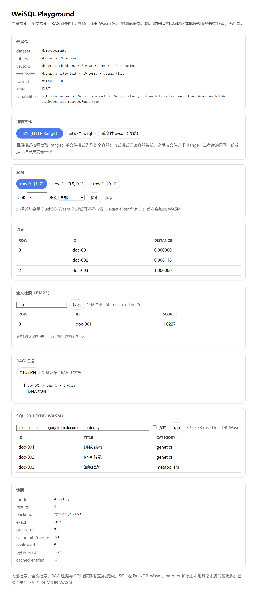

# WeiSQL AI

WeiSQL AI 是一个面向静态网站和嵌入式 AI 应用的只读数据运行时实验项目。数据集可以随应用发布到静态托管或 CDN，由浏览器或 Node.js 按需读取，无需单独部署数据库服务。

项目采用 TypeScript + Rust：TypeScript 提供公开 SDK、Manifest 校验、资源读取、Runtime 编排、精确向量检索与 Adapter 注入；Rust 提供用于对照的精确 Cosine 基线。DuckDB（Node.js）与 USearch 已作为 Adapter 实现并接入，DuckDB-Wasm 尚未验证。

> 当前状态：工程原型。Manifest V1 基础结构已冻结；L1/L2 校验、L3 资源完整性（尺寸 + SHA-256）、HTTP 与 Node 文件 Reader、Runtime 生命周期、TypeScript 精确向量检索、生成真实数据包的 Builder 首版，以及 Node.js DuckDB 只读 SQL Adapter 均已实现并有自动化测试。DuckDB-Wasm、ANN 和真实 CDN 部署仍在开发计划中。项目尚未发布 npm 包，也没有未经实测的性能承诺。

## 已实现

- 冻结的 Manifest V1 类型、JSON Schema 和运行时语义校验
- 表、列、主键、向量集合和 ID Map 跨字段引用检查
- 路径穿越、绝对路径、URL scheme、百分号编码和重复资源防护
- 向量及 UInt64 偏移文件字节数公式校验
- 浏览器兼容的 `HttpResourceReader`
- Node.js `NodeFileResourceReader`：包根 containment、符号链接逃逸防护和精确范围读取
- 有界 LRU 缓存与并发请求合并（`CachedResourceReader`），含发布版本隔离、取消所有权和命中统计
- 严格 HTTP Range、`Content-Range`、响应长度、取消和生命周期处理
- `open()` 双 Manifest 来源、`capabilities()`、只读 `state` 和幂等 `close()`
- 引擎无关的 `SqlAdapter` 注入边界（`open({ sqlAdapter })`）
- L3 资源完整性：`verifyChecksums` 的 `manifest`（尺寸）与 `all`（增量 SHA-256 + ID Map 内容）两种模式
- 零依赖增量 SHA-256，浏览器与 Node.js 同一实现
- `buildPackage()` Builder：接收已有 Parquet，生成 Float32、ID Map、真实摘要与 Manifest，暂存区自检后原子发布
- Node.js DuckDB 只读 SQL Adapter（`@weisql/duckdb-adapter`）：真实 SQL 查询、参数绑定、语句级只读边界、L4 Parquet 模式校验与原生取消
- 混合检索两策略：`exact-filter-first`（过滤先于 Top-K，结果严格）与 `vector-first`（有界候选窗口，诊断标注 `exact` 是否成立）
- `VectorAdapter` 注入契约（`open({ vectorAdapter })`）与精确搜索参考实现；ANN 实现必须如实声明 `exactSearch: false`
- USearch ANN Adapter（`@weisql/usearch-adapter`）：HNSW 索引（可持久化或现场构建）、三种度量映射、`diagnostics.exact: false` 如实标注
- 真实浏览器验收探针（`npm run probe:browser`）：Chromium 中验证 HTTP Range、L3 校验、精确搜索与缓存命中
- 跨环境对照（`npm run probe:parity`）：同一进程驱动 Node 与 Chromium，逐字段比较查询结果、`exact` 标记与错误码
- 可复现的基准装置（`npm run bench`）：合成数据包 + 完整性闸门 + p50/p95、I/O 字节与峰值内存；`--ann` 同时给出 Recall@K 对照，结果见 [基准测量装置](docs/BENCHMARK_HARNESS.md)
- `weisql validate` 校验命令（`@weisql/cli`）：L1/L2/L3 逐级校验、`--json` 输出与 CI 友好退出码
- 发布前静态检查（`npm run release:check`）：版本形状、workspace 依赖范围、`files` 清单、dist 产物与 README 齐备性
- 全文检索：Manifest `textIndexes`、倒排索引读取器（二分定位 + BM25 排序）、索引生成工具；Unicode 分词（CJK 按字），详见 [全文检索设计](docs/FULL_TEXT_SEARCH.md)
- 已接入公开 `vector.search()` 的端到端精确搜索
- Float32 little-endian 向量分块读取
- Cosine、L2、IP 统一距离语义
- 固定容量最大堆 Top-K
- JSONL + UInt64 偏移索引的随机 ID 读取
- 流式 TypeScript 精确搜索正确性基线
- Rust 精确 Cosine 搜索基线

## 尚未实现

- DuckDB-Wasm（浏览器）SQL Adapter（Node.js 端已实现）
- ANN 在真实数据集上的 Recall@K 评估与「ANN + 过滤」组合语义
- Builder 的 CSV/JSON → Parquet 生成与类型推断
- Parquet 内容级校验（L4，需要 SQL 引擎）
- WASM 构建与 TypeScript/Rust 自动黄金数据对照
- Netlify/CDN 的真实 CORS、Range 和缓存验收
- `.wsql` 单文件容器
- `text.search()` 的 Runtime 接入、RRF 融合与 RAG 集成层

## 快速开始

要求：

- Node.js 20 或更高版本
- npm
- 可选：Rust stable，用于运行 Rust 基线
- 可选：`@duckdb/node-api` 的平台预编译绑定，由 `npm install` 自动获取；SQL Adapter 测试需要它

安装并验证 TypeScript 工程：

```bash
npm install
npm test
npm run typecheck
npm run build
```

重新生成示例数据包（`examples/fixture`）：

```bash
npm run fixture
```

该命令调用 Builder，从 `examples/source/documents.parquet` 生成完整数据包并在发布前自检。源 Parquet 由 `python tools/make-source-parquet.py`（依赖 pyarrow）生成，属于不可变输入。

在真实浏览器中验证 SDK（需要 Chromium 或 Chrome/Edge）：

```bash
npm run probe:browser
npm run probe:playground   # 打开 Playground 并断言交互结果
npm run probe:parity       # Node 与 Chromium 结果对照（见 docs/ENVIRONMENT_PARITY.md）
npm run playground         # 手动浏览 http://127.0.0.1:8099/playground/
```

测试监听模式：

```bash
npm run test:watch
```

运行 Rust 基线：

```bash
cargo test --manifest-path crates/vector-benchmark/Cargo.toml
cargo run --release --manifest-path crates/vector-benchmark/Cargo.toml -- 10000 128 10
```

Rust 示例参数依次为向量数量、维度和 Top-K。该程序是确定性正确性与基准实验入口，不是生产 ANN 引擎。

## Manifest V1

数据包的逻辑布局：

```text
weisql-package/
├── manifest.json
├── data/
│   └── documents.parquet
└── vectors/
    ├── embeddings.f32
    ├── id-map.jsonl
    └── id-map.offsets
```

V1 的核心约定：

- `format` 固定为 `weisql`
- `formatVersion` 固定为 `1.0.0`
- 表数据使用 Parquet
- 向量使用 `f32-le-row-major`
- ID Map 使用 UTF-8 JSONL
- 随机访问偏移使用 little-endian UInt64
- Cosine 距离为 `1 - similarity`
- L2 为欧氏距离
- IP 为负内积
- 所有距离越小越相似

完整规范见 [Manifest V1](docs/MANIFEST_SPEC_V1.md)，机器可读结构见 [JSON Schema](docs/MANIFEST_SCHEMA_V1.json)。示例中的大小和摘要是占位值，不对应真实资源。

校验外部 Manifest：

```ts
import { validateManifest } from "@weisql/sdk";

const manifest = validateManifest(JSON.parse(source));
console.log(manifest.datasetId);
```

## HTTP Range 读取

```ts
import { HttpResourceReader } from "@weisql/sdk";

const reader = new HttpResourceReader({
  baseUrl: "https://example.test/datasets/demo/",
});

const bytes = await reader.readRange(
  "vectors/embeddings.f32",
  { start: 0, end: 4096 },
);

await reader.close();
```

Range 使用左闭右开区间 `[start, end)`。服务端必须正确返回 `206 Partial Content` 和匹配的 `Content-Range`；返回 `200` 的整文件响应不会被误当成局部数据。

### 缓存与并发

`CachedResourceReader` 是装饰器，`open({ cache })` 会自动套上它：

```ts
const db = await open({
  manifestUrl: "https://example.test/datasets/demo/manifest.json",
  resourceReader: new HttpResourceReader({ baseUrl: "https://example.test/datasets/demo/" }),
  cache: { maxCacheBytes: 32 * 1024 * 1024, maxEntryBytes: 1024 * 1024, maxConcurrentReads: 8 },
});
```

- 缓存键为「发布版本身份 + 路径 + 起止」；`setPublicationVersion()` 换版本即清空，避免新旧发布混用。
- 按实际字节数做有界 LRU 淘汰，单条上限 `maxEntryBytes`，超过则直接绕过缓存。
- 相同键的并发请求合并成一次底层读取；**只有全部等待者都取消**才中断底层，单个调用方取消不影响其他人。
- 失败、短读、被取消的读取都不会进入缓存。
- 命中返回副本：调用方改动返回值不会污染缓存。
- `stats()` 提供 `hits / misses / coalesced / bypasses / evictions / entries / cachedBytes / bytesRead`，用于基准报告。

## 精确向量搜索基线

当前 TypeScript 搜索链路为：

```text
ResourceReader
  → VectorBlockReader
  → Float32 LE 解码
  → Cosine / L2 / IP
  → TopKMaxHeap
  → IndexedIdMapReader
  → 业务 ID 结果
```

搜索只保留一个解码块和 Top-K 候选，并在距离扫描结束后读取最终候选的业务 ID。分块能够降低峰值内存，但不会减少精确搜索的总网络读取量和计算量。

详情见 [TypeScript 精确搜索基线](docs/EXACT_VECTOR_BASELINE.md)。

## 构建数据包

V1 Builder 接收**已存在的 Parquet 文件**（不负责 CSV/JSON 推断），生成 Float32 向量、ID Map、真实字节数与 SHA-256，并在发布前重新读取整个暂存区做 L1/L2/L3 自检：

```ts
import { buildPackage } from "@weisql/sdk";

const report = await buildPackage({
  outputDirectory: "fixture",
  datasetId: "demo-documents",
  tables: [{
    name: "documents",
    parquetPath: "source/documents.parquet",
    columns: [
      { name: "id", type: "string", nullable: false },
      { name: "title", type: "string", nullable: false },
    ],
    primaryKey: ["id"],
    rowIds: ["doc-001", "doc-002", "doc-003"],
  }],
  vectorCollections: [{
    name: "document_embeddings",
    tableName: "documents",
    idColumn: "id",
    metric: "cosine",
    vectors: [[1, 0], [0.9, 0.1], [0, 1]],
    ids: ["doc-001", "doc-002", "doc-003"],
  }],
});
```

构建阶段为 `CREATED → VALIDATING → BUILDING → VERIFYING → PUBLISHING → PUBLISHED`，任一阶段失败进入 `FAILED` 并清理暂存区。默认拒绝覆盖已有目录；`overwrite: true` 时先把旧目录移走，成功后才删除，失败则回滚。

未提供 `rowIds` 时，Builder 不会假装完成主键交叉校验，而是在 `report.warnings` 中报告 `id-membership-unverified`。

## 校验数据包

发布前自检不需要打开 Runtime，直接用 CLI：

```bash
npx weisql validate ./examples/fixture
npx weisql validate ./examples/fixture --json --mode all
```

```
package:   D:\github\WeiSQL\examples\fixture
dataset:   demo-documents
tables:    1 (documents)
vectors:   1 (document_embeddings: 3 rows, dimension 2, cosine)
mode:      all
resources: 4 checked, 4 sizes verified, 4 hashes verified, 955 declared bytes
OK
```

- 依次执行 L1/L2 结构校验与 L3 资源完整性；`--mode manifest` 只比对长度，`--mode none` 只做结构校验，输出会如实反映实际验证到哪一级。
- 退出码：`0` 有效、`1` 无效、`2` 用法错误，可直接接入 CI 或发布脚本。
- `--json` 输出机器可读结果，包含 `issues[].stage`、`code` 与 `details.path`。
- 失败示例：`[resources] RESOURCE_INTEGRITY_FAILED: Resource SHA-256 does not match the Manifest (vectors/document_embeddings.f32)`。

## 示例应用（Playground）

```bash
npm run playground     # http://127.0.0.1:8099/playground/
```

页面从静态服务按需读取 `examples/fixture`，没有后端：

- 查询向量不是硬编码的——页面直接从 `vectors/*.f32` 读前 3 行作为预设，点选即检索；
- 结果展示 `row` / `id` / `distance`，诊断区给出后端、`exact`、耗时与缓存命中统计；
- SQL 与混合检索在此不可用，因为浏览器端需要 DuckDB-Wasm（扩展下载受阻，见 [ADR-020](docs/DECISION_LOG.md)）。

自动化验收：`npm run probe:playground` 在真实 Chromium 中打开页面，断言初始结果为 `doc-001..doc-003`，再点击第三个预设并断言 `doc-003` 排到第一。



截图由 `node tools/browser-probe/screenshot.mjs docs/assets/playground.png` 生成。

## 资源完整性校验

`open()` 的 `verifyChecksums` 有三种策略，语义与 `RESOURCE_INTEGRITY_SPEC.md` 一致：

| 策略 | 行为 |
| --- | --- |
| `none`（默认） | 只做 L1/L2，不访问任何资源 |
| `manifest` | 用 `stat` 校验每个资源实际长度，不做完整读取 |
| `all` | 分块增量计算 SHA-256，并校验 ID Map 偏移与 JSONL 内容 |

`all` 模式会验证字节内容一致性；`manifest` 只保证长度，**不使用 `all` 就无法发现同长度的内容篡改**。完整性校验在任何 Adapter 接触资源之前执行，需要同时提供 `resourceReader`。

## Runtime API

```ts
import { open, HttpResourceReader } from "@weisql/sdk";

const db = await open({
  manifestUrl: "https://example.test/datasets/demo/manifest.json",
  resourceReader: new HttpResourceReader({
    baseUrl: "https://example.test/datasets/demo/",
  }),
});

const hits = await db.vector.search("document_embeddings", query, { topK: 10 });
db.capabilities(); // { sql, vectorExactSearch, vectorAnnSearch, hybridSearch, resourceRange }
await db.close();
```

`manifestUrl` 与已解析的 `manifest` 必须二选一，两条路径都经过同一套运行时校验。注入 `resourceReader` 后，`vector.search()` 执行完整闭环（Range 读取 → Float32 解码 → 距离扫描 → Top-K → Indexed ID Map → 业务 ID），并在 `diagnostics` 中标记 `exact: true`。

未注入 Reader 时返回 `INDEX_NOT_FOUND`，未注入 `sqlAdapter` 时 `sql()` 返回 `SQL_UNSUPPORTED`，两者都不会返回模拟数据。

## SQL 查询

Node.js 端通过独立包 `@weisql/duckdb-adapter` 接入真实 DuckDB，SDK 本身仍然零引擎依赖：

```ts
import { open, NodeFileResourceReader } from "@weisql/sdk";
import { createDuckDbAdapter } from "@weisql/duckdb-adapter";

const db = await open({
  manifestUrl: "https://example.test/datasets/demo/manifest.json",
  resourceReader: new NodeFileResourceReader({ rootDirectory: "./demo" }),
  sqlAdapter: createDuckDbAdapter(),
});

const rows = await db.sql(
  "select id, title from documents where category = ? order by id",
  ["genetics"],
);
```

边界与取舍：

- **只读由引擎的语句分类保证**：只执行 `SELECT` 与 `EXPLAIN` 预处理语句，`INSERT`/`UPDATE`/`DELETE`/`COPY`/`CREATE`/`ALTER`/`SET`/`CALL` 一律返回 `SQL_UNSUPPORTED`。不依赖关键字过滤，`WITH ... DELETE` 同样被拒绝。
- **单语句**：`prepare()` 直接拒绝多语句输入，一次调用无法夹带第二条语句。
- **外部文件访问关闭**：`open()` 最后设置 `enable_external_access=false` 与 `lock_configuration=true`，因此用户 SQL 里的 `read_parquet('/etc/passwd')` 会被拒绝。
- **表会被物化进内存**：为满足上一条边界，Adapter 用 `CREATE TABLE ... AS SELECT` 把 Parquet 载入内存库，而不是保留需要查询期文件访问的视图。内存成本约等于表数据量，由 `maxTableBytes`（默认 256 MiB）兜底。
- **L4 校验**：表载入后按 Manifest 的列名与类型比对 `DESCRIBE` 结果，不一致返回 `RESOURCE_INTEGRITY_FAILED`；可用 `verifyTableSchema: false` 关闭。
- **取消是原生的**：通过 `connection.interrupt()` 中断执行中的查询，能力声明为 `cancellation: "native"`。
- **表加载模式**：默认 `memory`（物化进内存 + 关闭外部文件访问）；大表可显式选择 `lazy`（临时文件 + 视图 + **保留**外部访问），后者只适用于 SQL 由应用作者编写的场景。详见 [表加载模式](docs/TABLE_LOADING_OPTIONS.md)。
- **已知限制**：`DECIMAL` 由驱动转换为 `number`，超过 15 位有效数字会丢精度；可空性不在 L4 比对范围内（`read_parquet` 不保留 `NOT NULL` 约束）。

详见 [DuckDB Adapter](docs/DUCKDB_ADAPTER.md)。

## 过滤与混合检索

`vector.search()` 接受 `filter`，语义是「字段 = 标量」的 AND 等值条件，并提供两种策略。

**`exact-filter-first`（默认）** —— 先求出完整过滤集合，再在集合内做精确比较：

```ts
const hits = await db.vector.search("document_embeddings", [1, 0], {
  topK: 2,
  filter: { category: "genetics" },
});
// hits[i].diagnostics → { strategy: "exact-filter-first", exact: true, filteredCandidates: 2 }
```

- **过滤发生在 Top-K 之前**：先用 SQL 求出满足条件的完整 ID 集合，再映射成向量行，最后只在这些行上做精确比较。所以结果仍是「过滤子集上的严格最近 K」，`exact: true` 站得住。
- 反过来（先取 Top-K 再丢弃不匹配项）会少返回结果，也不能声明 `exact`，因此没有采用。
- 每次查询要付一次 SQL + 一次完整 ID Map 扫描（业务 ID → 向量行）。V1 没有持久化反向索引。

**`vector-first`** —— 先取有界候选窗口，再用 SQL 过滤：

```ts
const hits = await db.vector.search("document_embeddings", [1, 0], {
  topK: 2,
  filter: { category: "genetics" },
  strategy: "vector-first",
  vectorFirst: { initialCandidates: 2, expansionStep: 2, maxCandidates: 50 },
});
// 诊断包含 candidatesScanned / filteredCandidates / candidateCap
```

- 候选窗口按 `initialCandidates` 起步，不足 `topK` 时按 `expansionStep` 扩张，直到 `maxCandidates`。
- **不保证是过滤子集上的严格最近 K**：只有窗口覆盖了整个集合时才置 `exact: true`（靠穷尽，而非靠构造）。命中数可以少于 `topK`，诊断会如实给出原因。
- 它省掉的是全量 ID Map 扫描，不是向量扫描——V1 没有 ANN，向量仍需全量过一遍。它的真正意义是为后续 ANN 提供正确形状。

**共同约束**：

- 需要 `sqlAdapter`；未注入时返回 `SQL_UNSUPPORTED`，不会静默忽略过滤条件。
- 字段必须在 Manifest 中声明（未知列 → `INVALID_ARGUMENT`），值按列类型校验并全部参数绑定，`null` 编译为 `IS NULL`。
- `date`/`timestamp`/`json` 的等值过滤尚未支持，会明确报错而不是静默匹配不到。
- 只传 `strategy` 不传 `filter` 会返回 `INVALID_ARGUMENT`。

## 仓库结构

```text
crates/vector-benchmark/   Rust 精确 Cosine 基线
docs/                      格式、Adapter、安全、基准和路线文档
examples/manifest/         Manifest 正例与安全负例
examples/source/           Builder 的不可变 Parquet 输入
examples/fixture/          Builder 生成的真实数据包示例
packages/sdk/              TypeScript SDK、资源层、Builder 和向量基线
packages/duckdb-adapter/   Node.js DuckDB 只读 SQL Adapter
packages/usearch-adapter/  USearch ANN VectorAdapter（内存索引）
packages/cli/              `weisql validate` 数据包校验命令
examples/playground/       浏览器端示例应用（向量检索演示）
tools/                     源 Parquet、ANN/全文索引生成、基准与浏览器探针脚本
```

## 主要文档

- [总体技术规范](docs/TECHNICAL_SPEC_V1.md)
- [工程路线图](docs/ENGINEERING_ROADMAP.md)
- [Manifest V1](docs/MANIFEST_SPEC_V1.md)
- [Manifest Validator 与 Builder 工程规范](docs/MANIFEST_VALIDATOR_BUILDER_SPEC.md)
- [SDK API 契约](docs/SDK_API_CONTRACT_V1.md)
- [V1 公共类型与错误契约](docs/PUBLIC_TYPES_AND_ERRORS_V1.md)
- [SQL Adapter 契约](docs/SQL_ADAPTER_CONTRACT.md)
- [DuckDB Adapter](docs/DUCKDB_ADAPTER.md)
- [表加载模式对比](docs/TABLE_LOADING_OPTIONS.md)
- [跨环境兼容性对照](docs/ENVIRONMENT_PARITY.md)
- [Vector Adapter 契约](docs/VECTOR_ADAPTER_CONTRACT.md)
- [ResourceReader 契约](docs/RESOURCE_READER_CONTRACT.md)
- [资源完整性校验规范](docs/RESOURCE_INTEGRITY_SPEC.md)
- [V0.6 Runtime 基础设计](docs/V0_6_RUNTIME_FOUNDATION.md)
- [V0.7 Runtime API 与混合查询设计](docs/V0_7_RUNTIME_AND_HYBRID.md)
- [V0.8 工程分层与 V1 交付范围](docs/V0_8_ENGINEERING_AND_DELIVERY.md)
- [浏览器与 Node.js Runtime 兼容性](docs/RUNTIME_COMPATIBILITY.md)
- [端到端验收计划](docs/E2E_ACCEPTANCE_PLAN.md)
- [V0.5 验收清单](docs/V0_5_ACCEPTANCE.md)
- [基准测试协议](docs/BENCHMARK_PROTOCOL_V1.md)
- [基准测量装置](docs/BENCHMARK_HARNESS.md)
- [ANN 可行性探测](docs/ANN_FEASIBILITY.md)
- [USearch Adapter](docs/USEARCH_ADAPTER.md)
- [发布流程](docs/RELEASE_PROCESS.md)
- [全文检索设计](docs/FULL_TEXT_SEARCH.md)
- [变更日志](CHANGELOG.md)
- [技术决策记录](docs/DECISION_LOG.md)

## 安全边界

- Manifest 和所有远程文件均视为不可信输入。
- 资源路径必须是数据包内的规范相对路径。
- SQL 参数必须使用引擎参数绑定，不允许插值不可信值。
- SHA-256 用于检测内容是否与 Manifest 声明一致，不证明发布者身份。
- 静态数据包默认可被下载，不得包含 API Key、访问令牌或私密数据。
- 示例摘要和字节数仅用于展示格式，不得用于正式发布。

## 开发顺序

当前建议顺序：

1. ~~实现 Builder 和真实三记录 fixture~~（首版已完成，`examples/fixture`）
2. ~~实现 L3 文件长度与 SHA-256 校验~~（已完成，`verifyChecksums`）
3. ~~接入 Node.js DuckDB Adapter~~（已完成，`packages/duckdb-adapter`）
4. ~~完成 SQL + 精确向量搜索端到端测试~~（已完成，见适配器测试）
5. 验证 DuckDB-Wasm 和静态 CDN
6. 在正确性基线稳定后接入 ANN 并运行性能协议

第 5 步是当前瓶颈：浏览器侧还没有任何已验证的引擎路径，Node 端的结论不能外推到 WASM。

在真实测试报告完成前，不对百万级向量延迟、浏览器内存、ANN 召回率或 CDN 随机访问效率作产品承诺。
