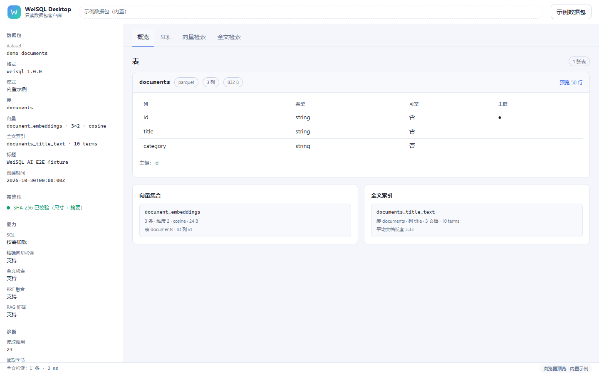

# WeiSQL AI

[](https://github.com/fengjutian/WeiSQL/actions/workflows/ci.yml)

WeiSQL AI 是一个面向静态网站和嵌入式 AI 应用的只读数据运行时实验项目。数据集可以随应用发布到静态托管或 CDN，由浏览器或 Node.js 按需读取，无需单独部署数据库服务。

项目采用 TypeScript + Rust：TypeScript 提供公开 SDK、Manifest 校验、资源读取、Runtime 编排、精确向量检索与 Adapter 注入；Rust 提供用于对照的精确 Cosine 基线。DuckDB（Node.js）、DuckDB-Wasm（浏览器）与 USearch 均已作为 Adapter 实现并接入。

产品文档站源码在 [`website/`](website/README.md)：首次运行 `npm run docs:install`，然后 `npm run docs:dev`；构建用 `npm run docs:build`。

桌面客户端的设计见 [WeiSQL Desktop 客户端设计](docs/DESKTOP_CLIENT.md)（Tauri 2，范围、IPC 契约、验收与里程碑已定义）。[`apps/desktop/`](apps/desktop/README.md) 下是探索性脚手架：前端与浏览器端查询链路已跑通，Tauri 原生层尚未达到可运行状态，**当前不作为交付物**，后续按设计文档继续开发。



> 当前状态：工程原型。Manifest V1 基础结构已冻结；L1/L2 校验、L3 资源完整性（尺寸 + SHA-256）、HTTP 与 Node 文件 Reader、Runtime 生命周期、TypeScript 精确向量检索、全文检索与 RRF 融合、生成真实数据包的 Builder 首版、Node.js DuckDB 只读 SQL Adapter、DuckDB-Wasm 浏览器 SQL Adapter（parquet 扩展自托管）以及 USearch ANN Adapter 均已实现并有自动化测试。浏览器 SQL 不支持 `Date`/二进制参数、ANN 在真实数据集上的召回评估与真实 CDN 部署仍未完成。项目尚未发布 npm 包，也没有未经实测的性能承诺。

## 已实现

- 冻结的 Manifest V1 类型、JSON Schema 和运行时语义校验
- 表、列、主键、向量集合和 ID Map 跨字段引用检查
- 路径穿越、绝对路径、URL scheme、百分号编码和重复资源防护
- 向量及 UInt64 偏移文件字节数公式校验
- 浏览器兼容的 `HttpResourceReader`
- Node.js `NodeFileResourceReader`：包根 containment、符号链接逃逸防护和精确范围读取
- 有界 LRU 缓存与并发请求合并（`CachedResourceReader`），含发布版本隔离、取消所有权和命中统计
- 严格 HTTP Range、`Content-Range`、响应长度、取消和生命周期处理
- `open()` 双 Manifest 来源、`capabilities()`、只读 `state` 和幂等 `close()`
- 引擎无关的 `SqlAdapter` 注入边界（`open({ sqlAdapter })`）
- L3 资源完整性：`verifyChecksums` 的 `manifest`（尺寸）与 `all`（增量 SHA-256 + ID Map 内容）两种模式
- 零依赖增量 SHA-256，浏览器与 Node.js 同一实现
- `buildPackage()` Builder：接收已有 Parquet，生成 Float32、ID Map、真实摘要与 Manifest，暂存区自检后原子发布
- Node.js DuckDB 只读 SQL Adapter（`@weisql/duckdb-adapter`）：真实 SQL 查询、参数绑定、语句级只读边界、L4 Parquet 模式校验与原生取消
- DuckDB-Wasm 浏览器 SQL Adapter（`@weisql/duckdb-wasm-adapter`）：Worker 内真实 DuckDB、表从 `ResourceReader` 字节物化、parquet 扩展同源自托管、tokenizer 判定的只读边界（含只读 CTE）、L4 校验；限制见 [DuckDB-Wasm Adapter](docs/DUCKDB_WASM_ADAPTER.md)
- 可选 OPFS 缓存（`persistToOpfs`）：表摘要派生缓存键，命中时跳过物化但仍跑 L4，`flushFiles()` 保证落盘；真实 Chromium 探针断言第二次 `open()` 复用
- 混合检索两策略：`exact-filter-first`（过滤先于 Top-K，结果严格）与 `vector-first`（有界候选窗口，诊断标注 `exact` 是否成立）
- `VectorAdapter` 注入契约（`open({ vectorAdapter })`）与精确搜索参考实现；ANN 实现必须如实声明 `exactSearch: false`
- USearch ANN Adapter（`@weisql/usearch-adapter`）：HNSW 索引（可持久化或现场构建）、三种度量映射、`diagnostics.exact: false` 如实标注、可选的后过滤模式（`diagnostics.postFiltered` 自曝不完整）
- 真实浏览器验收探针（`npm run probe:browser`）：Chromium 中验证 HTTP Range、L3 校验、精确搜索与缓存命中
- 浏览器 SQL 验收探针（`npm run probe:wasm`）：Chromium 中验证 DuckDB-Wasm 物化、参数绑定、只读拒绝与 `capabilities().sql`
- 跨环境对照（`npm run probe:parity`）：同一进程驱动 Node 与 Chromium，逐字段比较向量检索、全文检索、RAG 证据、SQL（含只读 CTE 与流式 `sqlStream()`）、`.wsql` 容器与错误码
- SQL Adapter 共享契约（`npm run test:contract`）：同一组 SQL 用例同时跑 Node DuckDB 与 DuckDB-Wasm，差异必须在用例表里显式声明
- 可复现的基准装置（`npm run bench`）：合成数据包 + 完整性闸门 + p50/p95、I/O 字节与峰值内存；`--ann` 给出 Recall@K 对照，`--text` 测量 BM25 构建、体积与延迟，`--fusion` 测量 RRF `k` 的稳定性，结果见 [基准测量装置](docs/BENCHMARK_HARNESS.md)
- DuckDB-Wasm 物化基准（`npm run bench:wasm`）：5 万–50 万行合成 Parquet 的 `open()`、过滤查询与 RSS 增量，结果见 [基准测量装置](docs/BENCHMARK_HARNESS.md)
- 浏览器流式基准（`npm run bench:wasm-stream`）：Chromium 中 `sqlStream()` 的首行延迟、吞吐与堆增量，结果见 [基准测量装置](docs/BENCHMARK_HARNESS.md)
- 浏览器冷启动基准（`npm run bench:wasm-cold`）：关闭 HTTP 缓存后的 36.3 MB 首载与 `open()` 时间，结果见同一文档
- `weisql validate` 校验命令（`@weisql/cli`）：L1/L2/L3 逐级校验、`--l4` 额外核对 Parquet 内容（需 `@weisql/duckdb-adapter`）、`--json` 输出与 CI 友好退出码
- `.wsql` 单文件容器：`weisql pack` 打包（`--compress` 走 gzip 的 1.1.0 格式、`--only-declared` 只打声明资源并报告被跳过的文件）、`weisql validate <file>.wsql` 校验、`weisql unpack` 解包（先验摘要再写盘、拒绝路径穿越），SDK 提供 `ContainerReader` 与流式 `StreamingContainerReader` 直接作为 `resourceReader`，详见 [容器格式](docs/WSQL_CONTAINER.md)
- `weisql inspect`：不打开 Runtime 就列出表、向量、全文索引、签名状态与**未被 Manifest 声明的文件**
- 发布前静态检查（`npm run release:check`）：版本形状、workspace 依赖范围、`files` 清单、`publishConfig.access`、`repository`/`homepage`/`keywords`、dist 产物与 README 齐备性；`npm run release:publish` 按依赖顺序预检并发布（默认 dry run）
- Manifest 签名：Ed25519（WebCrypto），`weisql keygen/sign/verify-signature`，`validate --signature --trusted <keyId>` 可固定发布者；`sign --add` 追加协同签名，用于密钥轮换；`--require <n>` 要求 n 个固定密钥都签过名（背书策略）；SDK 与 CLI 均支持根密钥授权：`weisql authorize <pkg> --root root.key.pem --signer release.pub.pem --key release.key.pem --days 365`，消费者用 `--trusted-root <keyId>` 验签
- 全文检索：Manifest `textIndexes`、倒排索引读取器（二分定位 + BM25）、生成工具，以及公开 `db.text.search()`；Unicode 分词（CJK 按字），详见 [全文检索设计](docs/FULL_TEXT_SEARCH.md)
- RRF 融合检索：`db.hybrid.search()` 按排名融合向量与全文结果，返回两路名次与原始分数
- RAG 证据组装：`db.rag.search()` 在字符预算内返回带来源与名次的证据片段（不调用模型、不拼 prompt）；截断优先落在句末，其次词边界，`boundary` 标注实际切点
- 已接入公开 `vector.search()` 的端到端精确搜索
- Float32 little-endian 向量分块读取
- Cosine、L2、IP 统一距离语义
- 固定容量最大堆 Top-K
- JSONL + UInt64 偏移索引的随机 ID 读取
- 流式 TypeScript 精确搜索正确性基线
- Rust 精确 Cosine 搜索基线（单次扫描、`f64` 累加、定容最大堆）
- TypeScript ↔ Rust 跨语言黄金对照：同一固定数据集两侧排名与距离一致（6 个用例，CI 双向校验）
- WASM 构建（`npm run build:wasm`）：无 wasm-bindgen、无导入的 17 KB 模块，cosine/L2/IP 三种度量，同一 fixture 第三方实现对照（`npm run test:wasm-golden`）
- WASM Vector Adapter（`createWasmVectorAdapter`）：把该产物接成 `VectorAdapter`，与 TypeScript 精确适配器逐字段对照（`npm run test:wasm-adapter`）
- HNSW 备选索引（`crates/vector-hnsw`）：纯 Rust、零依赖、种子可复现；2000×32 聚类数据 Recall@10 = 1.00，p50 查询 0.048 ms
- HNSW 的 WASM 模块（`npm run build:hnsw-wasm`）：41 KB、单实例持有一个索引，1000×16 数据 Recall@10 = 1.00、p50 0.033 ms（`npm run test:hnsw-wasm`）
- HNSW Vector Adapter（`createHnswWasmVectorAdapter`）：如实声明 `exactSearch: false`，过滤走超额召回后置筛选（`postFiltering: true`）；对精确适配器 Recall@10 ≥ 0.9（`npm run test:hnsw-adapter`）

## 尚未实现 / 未验证

- 浏览器 SQL 的 `Date`/二进制参数（当前明确拒绝）；见 [DuckDB-Wasm Adapter](docs/DUCKDB_WASM_ADAPTER.md)
- 浏览器端 OPFS 缓存已实现为 opt-in（`persistToOpfs`，保留最近 4 个数据库，跨标签页用 Web Locks、第二个标签页回退内存）；多线程/COI 已试且不可用（见 ADR-063）；36.3 MB 首载已实测（`bench:wasm-cold`），CDN 下的冷启动仍未测
- `db.sql()` 仍一次性返回全部行；需要增量消费时用 `db.sqlStream()`（流式 API 已提供）
- ANN 在真实数据集上的 Recall@K 评估；ANN 后过滤的完整性保证
- 时间戳的自动推断（需用 `--timestamp` 显式声明；嵌套 JSON 列已支持，见 [源数据转换](docs/SOURCE_CONVERSION.md)）
- WASM adapter 的产物分发与浏览器实测（adapter 已实现并对照通过，但 `.wasm` 未随 npm 包发布，也尚未在 Chromium 中跑通）
- 真实 CDN（CORS、Range、缓存）与多机/冷缓存验收
- npm 发布（元数据与发布脚本已就绪，缺 npm 组织与访问令牌）

## 快速开始

要求：

- Node.js 20 或更高版本
- npm
- 可选：Rust stable，用于运行 Rust 基线
- 可选：`@duckdb/node-api` 的平台预编译绑定，由 `npm install` 自动获取；SQL Adapter 测试需要它

安装并验证 TypeScript 工程：

```bash
npm install
npm test
npm run test:contract   # 同一套 SQL 契约跑 Node 与 DuckDB-Wasm 两个适配器
npm run typecheck
npm run build
```

重新生成示例数据包（`examples/fixture`）：

```bash
npm run fixture
```

该命令调用 Builder，从 `examples/source/documents.parquet` 生成完整数据包并在发布前自检。源 Parquet 由 `python tools/make-source-parquet.py`（依赖 pyarrow）生成，属于不可变输入。

在真实浏览器中验证 SDK（需要 Chromium 或 Chrome/Edge；CI 的 `browser` 作业会在 Ubuntu runner 自带的 Chrome 上跑这四条探针）：

```bash
npm run probe:browser
npm run probe:wasm         # 浏览器 SQL（DuckDB-Wasm），首次会下载 parquet 扩展
npm run probe:playground   # 打开 Playground 并断言交互结果
npm run probe:parity       # Node 与 Chromium 结果对照（见 docs/ENVIRONMENT_PARITY.md）
npm run probe:opfs-lock    # 双标签页 OPFS 锁：第二个页面回退内存
npm run playground         # 手动浏览 http://127.0.0.1:8099/playground/
```

测试监听模式：

```bash
npm run test:watch
```

运行 Rust 基线：

```bash
cargo test --manifest-path crates/vector-benchmark/Cargo.toml
cargo run --release --manifest-path crates/vector-benchmark/Cargo.toml -- 10000 128 10
npm run test:rust-golden   # 校验提交的跨语言 fixture 仍等于 TypeScript 输出
npm run build:wasm         # 构建 crates/vector-wasm（wasm32-unknown-unknown）
npm run test:wasm-golden   # 用同一 fixture 校验 WASM 产物
```

Rust 示例参数依次为向量数量、维度、Top-K 和可选的测量轮数（默认 5 轮，另有 1 轮预热）；参数非法时以退出码 2 拒绝，而不是静默回落默认值。输出包含 `best_ms`/`median_ms`/`mean_ms`/`worst_ms`。该程序是确定性正确性与基准实验入口，不是生产 ANN 引擎。CI 的 `rust vector baseline and wasm` 作业会执行四个 crate 的 `fmt`/`clippy`/`test`、一次 release 基准烟测、HNSW 召回烟测，以及两套 WASM 构建与对照。

HNSW 备选索引（`crates/vector-hnsw`，纯 Rust、无依赖、种子可复现）：

```bash
cargo test --manifest-path crates/vector-hnsw/Cargo.toml
cargo run --release --manifest-path crates/vector-hnsw/Cargo.toml --example recall
npm run build:hnsw-wasm
npm run test:hnsw-wasm
```

`examples/recall.rs` 在 2000×32 的确定性聚类数据上打印建图耗时、p50 查询延迟与 Recall@10；`test:hnsw-wasm` 则在 1000×16 数据上验证同一引擎编译到 WASM 后仍能建图并以 Recall@10 ≥ 0.9 检索。该索引只作为 USearch 之外的备选实现，`search()` 返回近似结果，调用方必须如实标注 `exact: false`。

跨语言黄金对照：`tools/bench/rust-golden.mjs` 用 SDK 的 `exactVectorSearch` 把 6 个固定数据集写入 `crates/vector-benchmark/tests/fixtures/exact_cosine_golden.txt`，Rust 的 `golden_tests.rs` 在 1e-6 容差内断言相同排名与距离。修改任一侧语义都会让 `npm run test:rust-golden` 或 `cargo test` 失败；需要更新基线时运行 `node tools/bench/rust-golden.mjs --write`。

WASM：[vector-wasm](crates/vector-wasm/src/lib.rs) 把 `exact_search_contiguous` 暴露为无导入的 C ABI（`weisql_alloc` / `weisql_search_topk` / `weisql_dealloc`，ABI v3，`metric` 取 0/1/2 对应 cosine/L2/IP，距离为 `f64`），发布构建约 17 KB。`tools/bench/wasm-baseline.mjs` 用两份 fixture（9 个用例）在 Node 中实例化并逐项断言，形成 TypeScript、原生 Rust、WASM 三方一致。

`createWasmVectorAdapter()` 把产物接到 Runtime 的适配器边界上，调用方只需提供模块字节：

```ts
import { open, createWasmVectorAdapter } from "@weisql/sdk";
const wasm = await createWasmVectorAdapter({ module: await (await fetch("/weisql_vector_wasm.wasm")).arrayBuffer() });
const db = await open("./pkg", { vectorAdapter: wasm });
```

适配器第一次搜索时按 `blockSize` 把整个集合读入 `Float32Array` 并缓存（包不可变），每次搜索再拷入 WASM 线性内存；因此内存约为 `count × dimension × 4` 字节。`tools/bench/wasm-adapter.mjs` 在同一份内存数据上比较 `createWasmVectorAdapter` 与 `createExactVectorAdapter` 的行号、业务 ID、距离和错误码。

同一条边界也支持 HNSW：

```ts
import { createHnswWasmVectorAdapter } from "@weisql/sdk";
const hnsw = await createHnswWasmVectorAdapter({ module: hnswBytes, m: 16, efConstruction: 200, efSearch: 64 });
```

它在首次查询某个集合时建图（一个模块实例只持有一个图，切换集合或度量会重建），`capabilities.exactSearch` 为 `false`；带 `allowedRows` 的查询先超额召回 `topK × oversample` 再筛选，结果按契约可能少于 `topK`，并标记 `diagnostics.postFiltered`。`tools/bench/hnsw-adapter.mjs` 用同一集合比较 Recall@10、每条距离与过滤边界。

## Manifest V1

数据包的逻辑布局：

```text
weisql-package/
├── manifest.json
├── data/
│   └── documents.parquet
└── vectors/
    ├── embeddings.f32
    ├── id-map.jsonl
    └── id-map.offsets
```

V1 的核心约定：

- `format` 固定为 `weisql`
- `formatVersion` 固定为 `1.0.0`
- 表数据使用 Parquet
- 向量使用 `f32-le-row-major`
- ID Map 使用 UTF-8 JSONL
- 随机访问偏移使用 little-endian UInt64
- Cosine 距离为 `1 - similarity`
- L2 为欧氏距离
- IP 为负内积
- 所有距离越小越相似

完整规范见 [Manifest V1](docs/MANIFEST_SPEC_V1.md)，机器可读结构见 [JSON Schema](docs/MANIFEST_SCHEMA_V1.json)。示例中的大小和摘要是占位值，不对应真实资源。

校验外部 Manifest：

```ts
import { validateManifest } from "@weisql/sdk";

const manifest = validateManifest(JSON.parse(source));
console.log(manifest.datasetId);
```

## HTTP Range 读取

```ts
import { HttpResourceReader } from "@weisql/sdk";

const reader = new HttpResourceReader({
  baseUrl: "https://example.test/datasets/demo/",
});

const bytes = await reader.readRange(
  "vectors/embeddings.f32",
  { start: 0, end: 4096 },
);

await reader.close();
```

Range 使用左闭右开区间 `[start, end)`。服务端必须正确返回 `206 Partial Content` 和匹配的 `Content-Range`；返回 `200` 的整文件响应不会被误当成局部数据。

### 缓存与并发

`CachedResourceReader` 是装饰器，`open({ cache })` 会自动套上它：

```ts
const db = await open({
  manifestUrl: "https://example.test/datasets/demo/manifest.json",
  resourceReader: new HttpResourceReader({ baseUrl: "https://example.test/datasets/demo/" }),
  cache: { maxCacheBytes: 32 * 1024 * 1024, maxEntryBytes: 1024 * 1024, maxConcurrentReads: 8 },
});
```

- 缓存键为「发布版本身份 + 路径 + 起止」；`setPublicationVersion()` 换版本即清空，避免新旧发布混用。
- 按实际字节数做有界 LRU 淘汰，单条上限 `maxEntryBytes`，超过则直接绕过缓存。
- 相同键的并发请求合并成一次底层读取；**只有全部等待者都取消**才中断底层，单个调用方取消不影响其他人。
- 失败、短读、被取消的读取都不会进入缓存。
- 命中返回副本：调用方改动返回值不会污染缓存。
- `stats()` 提供 `hits / misses / coalesced / bypasses / evictions / entries / cachedBytes / bytesRead`，用于基准报告。

## 精确向量搜索基线

当前 TypeScript 搜索链路为：

```text
ResourceReader
  → VectorBlockReader
  → Float32 LE 解码
  → Cosine / L2 / IP
  → TopKMaxHeap
  → IndexedIdMapReader
  → 业务 ID 结果
```

搜索只保留一个解码块和 Top-K 候选，并在距离扫描结束后读取最终候选的业务 ID。分块能够降低峰值内存，但不会减少精确搜索的总网络读取量和计算量。

详情见 [TypeScript 精确搜索基线](docs/EXACT_VECTOR_BASELINE.md)。

## 构建数据包

V1 Builder 接收**已存在的 Parquet 文件**（不负责 CSV/JSON 推断），生成 Float32 向量、ID Map、真实字节数与 SHA-256，并在发布前重新读取整个暂存区做 L1/L2/L3 自检：

```ts
import { buildPackage } from "@weisql/sdk";

const report = await buildPackage({
  outputDirectory: "fixture",
  datasetId: "demo-documents",
  tables: [{
    name: "documents",
    parquetPath: "source/documents.parquet",
    columns: [
      { name: "id", type: "string", nullable: false },
      { name: "title", type: "string", nullable: false },
    ],
    primaryKey: ["id"],
    rowIds: ["doc-001", "doc-002", "doc-003"],
  }],
  vectorCollections: [{
    name: "document_embeddings",
    tableName: "documents",
    idColumn: "id",
    metric: "cosine",
    vectors: [[1, 0], [0.9, 0.1], [0, 1]],
    ids: ["doc-001", "doc-002", "doc-003"],
  }],
});
```

构建阶段为 `CREATED → VALIDATING → BUILDING → VERIFYING → PUBLISHING → PUBLISHED`，任一阶段失败进入 `FAILED` 并清理暂存区。默认拒绝覆盖已有目录；`overwrite: true` 时先把旧目录移走，成功后才删除，失败则回滚。

未提供 `rowIds` 时，Builder 不会假装完成主键交叉校验，而是在 `report.warnings` 中报告 `id-membership-unverified`。

构建时即可签名：传入 `signing: { privateKeyPem, publicKeyPem }`，Manifest 在写入前完成 Ed25519 签名，`report.signature.keyId` 给出指纹。这样包从落盘那一刻起就是签名的，不依赖发布脚本事后补签。

### 从 CSV / JSON 生成 Parquet

Builder 不负责从 CSV/JSON 推断类型。这一步由工具完成，`hyparquet-writer` 只作为根目录的 devDependency，不进入任何发布包：

```bash
node tools/source-to-parquet.mjs rows.csv  --output source/documents.parquet
node tools/source-to-parquet.mjs rows.jsonl --output source/documents.parquet
```

输出会打印可直接粘进 Manifest 的列声明：

```json
{ "rows": 3, "parquetBytes": 536,
  "columns": [
    { "name": "id", "type": "string", "nullable": false },
    { "name": "rating", "type": "float64", "nullable": false }
  ] }
```

推断规则是保守的：JSON 保留原生类型，同一列混合类型直接报错；CSV 只在**无损**时转数字（`"001"` 保持字符串、`"1"` 变整数），布尔只认 `true`/`false`。详见 [源数据转换](docs/SOURCE_CONVERSION.md)。

## 校验数据包

发布前自检不需要打开 Runtime，直接用 CLI：

```bash
npx weisql validate ./examples/fixture
npx weisql validate ./examples/fixture --json --mode all
npx weisql validate ./examples/fixture --l4      # 额外核对 Parquet 内容，需要 @weisql/duckdb-adapter
```

```
package:   D:\github\WeiSQL\examples\fixture
dataset:   demo-documents
tables:    1 (documents)
vectors:   1 (document_embeddings: 3 rows, dimension 2, cosine)
mode:      all
resources: 4 checked, 4 sizes verified, 4 hashes verified, 955 declared bytes
OK
```

- 依次执行 L1/L2 结构校验与 L3 资源完整性；`--mode manifest` 只比对长度，`--mode none` 只做结构校验，输出会如实反映实际验证到哪一级。
- `--l4` 会通过 DuckDB 打开数据包，核对 Parquet 的列名、列类型与行数是否与 Manifest 一致；没有安装适配器时报 `[l4] SQL_UNSUPPORTED` 而不是崩溃。对 `.wsql` 容器同样可用。
- 退出码：`0` 有效、`1` 无效、`2` 用法错误，可直接接入 CI 或发布脚本。
- `--json` 输出机器可读结果，包含 `issues[].stage`、`code` 与 `details.path`。
- 失败示例：`[resources] RESOURCE_INTEGRITY_FAILED: Resource SHA-256 does not match the Manifest (vectors/document_embeddings.f32)`。

## 示例应用（Playground）

```bash
npm run playground     # http://127.0.0.1:8099/playground/
```

页面从静态服务按需读取数据包，没有后端：

- 查询向量不是硬编码的——页面直接从 `vectors/*.f32` 读前 3 行作为预设，点选即检索；
- 结果展示 `row` / `id` / `distance`，诊断区给出后端、`exact`、耗时与缓存命中统计；
- **加载方式切换**：同一个数据包可在「目录（HTTP Range 按需读取）」、「单文件 `.wsql`（整包取回）」与「单文件 `.wsql`（流式，只读头部 + 按文件请求）」之间切换，三者结果一致；
- **全文检索**：输入 `dna` 或 `细胞` 即可看到 BM25 排序与分数（分数越大越相关）；
- **RAG 证据**：一次点击在字符预算内组装证据，展示 id、名次、字符数与是否截断；
- 启动时会把 fixture 复制到临时目录并生成文本索引，仓库里不保留派生文件；
- **浏览器 SQL**：搜索框里可改 SQL，第一次点「运行」会加载 DuckDB-Wasm（约 34 MB）与同源 parquet 扩展，随后返回真实结果；勾选「流式」改用 `db.sqlStream()`，结果行边到边渲染；「上限」填行数会启用 `maxRows`（超限显示 `INVALID_ARGUMENT` 而不是截断）；写语句会以 `SQL_UNSUPPORTED` 拒绝，只读 CTE 可用。
- **浏览器过滤检索**：在「类别」里选 `genetics` 会走 `exact-filter-first`（先 SQL 过滤再精确比较），诊断显示 `backend=typescript-exact+sql-filter`、`exact=true`。

`npm run playground` 会自动把匹配的 parquet 扩展缓存到 `.cache/` 并由同一静态服务提供，因此浏览器无需跨域下载扩展。

自动化验收：`npm run probe:playground` 在真实 Chromium 中打开页面，断言初始结果为 `doc-001..doc-003`，点击第三个预设后 `doc-003` 排到第一，再断言全文检索命中 `doc-001`、RAG 证据包含正文，依次切换到整包与流式 `.wsql` 模式断言结果一致，最后点「运行」用 DuckDB-Wasm 查出同样的三行。


截图由 `node tools/browser-probe/screenshot.mjs docs/assets/playground.png` 生成。

## 资源完整性校验

`open()` 的 `verifyChecksums` 有三种策略，语义与 `RESOURCE_INTEGRITY_SPEC.md` 一致：

| 策略 | 行为 |
| --- | --- |
| `none`（默认） | 只做 L1/L2，不访问任何资源 |
| `manifest` | 用 `stat` 校验每个资源实际长度，不做完整读取 |
| `all` | 分块增量计算 SHA-256，并校验 ID Map 偏移与 JSONL 内容 |

`all` 模式会验证字节内容一致性；`manifest` 只保证长度，**不使用 `all` 就无法发现同长度的内容篡改**。完整性校验在任何 Adapter 接触资源之前执行，需要同时提供 `resourceReader`。

## Runtime API

```ts
import { open, HttpResourceReader } from "@weisql/sdk";

const db = await open({
  manifestUrl: "https://example.test/datasets/demo/manifest.json",
  resourceReader: new HttpResourceReader({
    baseUrl: "https://example.test/datasets/demo/",
  }),
});

const hits = await db.vector.search("document_embeddings", query, { topK: 10 });
db.capabilities(); // { sql, vectorExactSearch, vectorAnnSearch, hybridSearch, resourceRange }
await db.close();
```

`manifestUrl` 与已解析的 `manifest` 必须二选一，两条路径都经过同一套运行时校验。注入 `resourceReader` 后，`vector.search()` 执行完整闭环（Range 读取 → Float32 解码 → 距离扫描 → Top-K → Indexed ID Map → 业务 ID），并在 `diagnostics` 中标记 `exact: true`。

未注入 Reader 时返回 `INDEX_NOT_FOUND`，未注入 `sqlAdapter` 时 `sql()` 返回 `SQL_UNSUPPORTED`，两者都不会返回模拟数据。

## SQL 查询

Node.js 端通过独立包 `@weisql/duckdb-adapter` 接入真实 DuckDB，SDK 本身仍然零引擎依赖：

```ts
import { open, NodeFileResourceReader } from "@weisql/sdk";
import { createDuckDbAdapter } from "@weisql/duckdb-adapter";

const db = await open({
  manifestUrl: "https://example.test/datasets/demo/manifest.json",
  resourceReader: new NodeFileResourceReader({ rootDirectory: "./demo" }),
  sqlAdapter: createDuckDbAdapter(),
});

const rows = await db.sql(
  "select id, title from documents where category = ? order by id",
  ["genetics"],
);

// 大结果不必先放进数组：逐行消费，可随时 break。
for await (const row of await db.sqlStream("select id, title from documents")) {
  console.log(row.id);
}
```

边界与取舍：

- **只读由引擎的语句分类保证**：只执行 `SELECT` 与 `EXPLAIN` 预处理语句，`INSERT`/`UPDATE`/`DELETE`/`COPY`/`CREATE`/`ALTER`/`SET`/`CALL` 一律返回 `SQL_UNSUPPORTED`。不依赖关键字过滤，`WITH ... DELETE` 同样被拒绝。
- **单语句**：`prepare()` 直接拒绝多语句输入，一次调用无法夹带第二条语句。
- **结果行数预算 `maxRows`**：超过预算抛 `INVALID_ARGUMENT`（`details.maxRows`），不静默截断；普通 `SELECT`/`VALUES`/`TABLE` 会被改写为带 `LIMIT maxRows + 1` 的子查询，让引擎提前停止，元数据语句在返回后检查。
- **流式结果 `db.sqlStream()`**：按 chunk（约 2048 行）交付，不必把整表放进数组；`maxRows`/`signal` 语义与 `db.sql()` 相同，`break` 会关闭底层 result。
- **外部文件访问关闭**：`open()` 最后设置 `enable_external_access=false` 与 `lock_configuration=true`，因此用户 SQL 里的 `read_parquet('/etc/passwd')` 会被拒绝。
- **表会被物化进内存**：为满足上一条边界，Adapter 用 `CREATE TABLE ... AS SELECT` 把 Parquet 载入内存库，而不是保留需要查询期文件访问的视图。内存成本约等于表数据量，由两层声明字节预算兜底：单表 `maxTableBytes`（默认 256 MiB）与整包 `maxTotalTableBytes`（默认 512 MiB）；整包检查先于实例创建。
- **L4 校验**：表载入后按 Manifest 的列名与类型比对 `DESCRIBE` 结果，不一致返回 `RESOURCE_INTEGRITY_FAILED`；可用 `verifyTableSchema: false` 关闭。
- **取消是原生的**：通过 `connection.interrupt()` 中断执行中的查询，能力声明为 `cancellation: "native"`。
- **表加载模式**：默认 `memory`（物化进内存 + 关闭外部文件访问）；大表可显式选择 `lazy`（临时文件 + 视图 + **保留**外部访问），后者只适用于 SQL 由应用作者编写的场景。详见 [表加载模式](docs/TABLE_LOADING_OPTIONS.md)。
- **已知限制**：`DECIMAL` 由驱动转换为 `number`，超过 15 位有效数字会丢精度；可空性不在 L4 比对范围内（`read_parquet` 不保留 `NOT NULL` 约束）。

详见 [DuckDB Adapter](docs/DUCKDB_ADAPTER.md)。

### 浏览器端（DuckDB-Wasm）

`@weisql/duckdb-wasm-adapter` 把同一个 `SqlAdapter` 接口接到 DuckDB-Wasm 的 Worker 上：

```ts
import { createDuckDbWasmAdapter } from "@weisql/duckdb-wasm-adapter";

const db = await open({
  manifestUrl: "/datasets/demo/manifest.json",
  resourceReader: new HttpResourceReader({ baseUrl: "/datasets/demo/" }),
  sqlAdapter: createDuckDbWasmAdapter({
    bundles: {
      mainModule: "/vendor/duckdb/duckdb-eh.wasm",
      mainWorker: "/vendor/duckdb/duckdb-browser-eh.worker.js",
    },
    extensionRepository: `${location.origin}/extensions`,
  }),
});
```

- **表来自 SDK 的字节**：`ResourceReader.read()` 拿到 Parquet 后 `registerFileBuffer`，再 `CREATE TABLE ... AS SELECT`；DuckDB 不直接访问数据包 URL，L3 校验不会被绕过。
- **parquet 扩展必须同源托管**：`extensions.duckdb.org` 不返回 CORS 头，页面无法跨域下载；`npm run vendor:wasm-extension` 会按 WASM 核心版本缓存扩展，探针服务器把它挂在 `/extensions` 下。未配置时 `open()` 返回 `SQL_UNSUPPORTED`，不静默降级。
- **只读用首关键字白名单**：`SELECT`/`EXPLAIN`/`DESCRIBE`/`SHOW`/`SUMMARIZE`/`PIVOT`/`UNPIVOT`/`TABLE`/`VALUES`；`WITH` 交给 DuckDB 自己的 tokenizer 跳过 CTE 列表后判定真实动词，所以只读 CTE 可用、`WITH ... DELETE` 仍被拒绝。tokenizer 不可用时退回严格白名单（`WITH` 拒绝，`supportedFeatures` 不含 `cte`）。
- **参数受 JSON 限制**：只接受字符串、数字、布尔、`null` 与安全范围内的 `bigint`；`Date`、二进制与超范围整数返回 `INVALID_ARGUMENT`。
- **结果行数预算 `maxRows`**：与 Node 适配器同一语义——超限抛 `INVALID_ARGUMENT`，不截断；可包装的语句由引擎提前停止，`DESCRIBE`/`SHOW`/`EXPLAIN` 在返回后检查。
- **流式结果 `db.sqlStream()`**：用 `prepared.send()` 的 Arrow batch 流交付；取消仍立即停止等待、引擎可能继续跑完。
- **取消是 best-effort**，不是 `native`：查询中 abort 会立即返回 `QUERY_CANCELLED`（`details.engineMayStillRun: true`），但单线程 worker 里的查询不会被抢占——实测 202 ms 的查询在 50 ms abort 后 51 ms 返回，引擎仍会跑完。

实测（Chromium 1248、fixture 3 行、扩展已缓存）：`open()` 1.37–1.70 s，查询 < 50 ms。完整边界见 [DuckDB-Wasm Adapter](docs/DUCKDB_WASM_ADAPTER.md)，决策见 [ADR-065 / ADR-066](docs/DECISION_LOG.md)。

## 过滤与混合检索

`vector.search()` 接受 `filter`，条件是 AND 组合，支持等值、成员与范围：

```ts
filter: {
  category: "genetics",                  // 等值
  title: ["DNA", "RNA"],                  // IN
  score: { gte: 0.5, lt: 0.9 },           // 范围
  published: { gte: new Date("2026-01-01") }, // date/timestamp 支持 Date 或 ISO 字符串
}
```

也可以显式写 `{ in: [...] }`、`{ ne: value }`，或用 `null` 表示 `IS NULL`。条件全部参数绑定，字段必须在 Manifest 中声明。

**`exact-filter-first`（默认）** —— 先求出完整过滤集合，再在集合内做精确比较：

```ts
const hits = await db.vector.search("document_embeddings", [1, 0], {
  topK: 2,
  filter: { category: "genetics" },
});
// hits[i].diagnostics → { strategy: "exact-filter-first", exact: true, filteredCandidates: 2 }
```

- **过滤发生在 Top-K 之前**：先用 SQL 求出满足条件的完整 ID 集合，再映射成向量行，最后只在这些行上做精确比较。所以结果仍是「过滤子集上的严格最近 K」，`exact: true` 站得住。
- 反过来（先取 Top-K 再丢弃不匹配项）会少返回结果，也不能声明 `exact`，因此没有采用。
- 每次查询要付一次 SQL + 一次完整 ID Map 扫描（业务 ID → 向量行）。V1 没有持久化反向索引。
- **窄过滤只读取允许行**：按连续段合并读取向量，是否值得由「允许字节 + 请求数 × 请求开销」与整文件扫描的成本估算决定。散乱过滤会回退到顺序扫描（实测散乱 1/8 走选择性读取会慢 30 倍）；三条路径都有测试与基准数据。
- **持久化 `id → row` 反向索引**（Builder 生成）：过滤查询不再整份扫描 ID Map，而是加载索引一次后在内存二分。实测窄过滤 p50 从 327 ms 降到 17 ms，ID Map 读取从 4.0 MB/查询降到 480 B。

**`vector-first`** —— 先取有界候选窗口，再用 SQL 过滤：

```ts
const hits = await db.vector.search("document_embeddings", [1, 0], {
  topK: 2,
  filter: { category: "genetics" },
  strategy: "vector-first",
  vectorFirst: { initialCandidates: 2, expansionStep: 2, maxCandidates: 50 },
});
// 诊断包含 candidatesScanned / filteredCandidates / candidateCap
```

- 候选窗口按 `initialCandidates` 起步，不足 `topK` 时按 `expansionStep` 扩张，直到 `maxCandidates`。
- **不保证是过滤子集上的严格最近 K**：只有窗口覆盖了整个集合时才置 `exact: true`（靠穷尽，而非靠构造）。命中数可以少于 `topK`，诊断会如实给出原因。
- 它省掉的是全量 ID Map 扫描，不是向量扫描——V1 没有 ANN，向量仍需全量过一遍。它的真正意义是为后续 ANN 提供正确形状。

**共同约束**：

- 需要 `sqlAdapter`；未注入时返回 `SQL_UNSUPPORTED`，不会静默忽略过滤条件。浏览器端注入 `@weisql/duckdb-wasm-adapter` 后同样可用（`probe:wasm` 断言 `exact-filter-first` 与 `exact: true`）。
- 字段必须在 Manifest 中声明（未知列 → `INVALID_ARGUMENT`），值按列类型校验并全部参数绑定，`null` 编译为 `IS NULL`。
- `date`/`timestamp` 接受 `Date` 或 ISO 字符串并按列类型校验；`json` 的等值过滤仍然明确报错——JSON 相等需要规范化形式，猜测会静默匹配不到。
- `json` 列是不透明文本：需要 JSON 谓词时用 `db.sql()` 里的 `json_extract`（有测试覆盖），过滤 DSL 只给出带提示的拒绝；相等语义请在入库前生成规范化文本列并声明为 `string`（见 [ADR-064](docs/DECISION_LOG.md)）。
- 成员条件上限 1000 个值；`in` 不接受 `null`，范围不接受空条件或同时给 `gt` 与 `gte`。
- 只传 `strategy` 不传 `filter` 会返回 `INVALID_ARGUMENT`。

## 仓库结构

```text
crates/vector-benchmark/   Rust 精确 Cosine 基线
crates/vector-hnsw/        Pure Rust HNSW 备选索引
crates/vector-wasm/        WASM C ABI（无 wasm-bindgen，无导入）
docs/                      格式、Adapter、安全、基准和路线文档
examples/manifest/         Manifest 正例与安全负例
examples/source/           Builder 的不可变 Parquet 输入
examples/fixture/          Builder 生成的真实数据包示例
packages/sdk/              TypeScript SDK、资源层、Builder 和向量基线
packages/duckdb-adapter/   Node.js DuckDB 只读 SQL Adapter
packages/duckdb-wasm-adapter/ 浏览器 DuckDB-Wasm 只读 SQL Adapter
packages/usearch-adapter/  USearch ANN VectorAdapter（内存索引）
packages/cli/              `weisql validate` 数据包校验命令
examples/playground/       浏览器端示例应用（向量、全文与 RAG 演示）
tools/                     源 Parquet、ANN/全文索引生成、基准与浏览器探针脚本
```

## 主要文档

### 现状与契约

- [项目状态报告](docs/PROJECT_STATUS.md)：能力矩阵、全部实测数字及其边界、未实现项
- [总体技术规范](docs/TECHNICAL_SPEC_V1.md)
- [工程路线图](docs/ENGINEERING_ROADMAP.md)
- [Manifest V1](docs/MANIFEST_SPEC_V1.md)
- [Manifest Validator 与 Builder 工程规范](docs/MANIFEST_VALIDATOR_BUILDER_SPEC.md)
- [SDK API 契约](docs/SDK_API_CONTRACT_V1.md)
- [V1 公共类型与错误契约](docs/PUBLIC_TYPES_AND_ERRORS_V1.md)
- [SQL Adapter 契约](docs/SQL_ADAPTER_CONTRACT.md)
- [DuckDB Adapter](docs/DUCKDB_ADAPTER.md)
- [DuckDB-Wasm Adapter](docs/DUCKDB_WASM_ADAPTER.md)
- [表加载模式对比](docs/TABLE_LOADING_OPTIONS.md)
- [跨环境兼容性对照](docs/ENVIRONMENT_PARITY.md)
- [Vector Adapter 契约](docs/VECTOR_ADAPTER_CONTRACT.md)
- [ResourceReader 契约](docs/RESOURCE_READER_CONTRACT.md)
- [资源完整性校验规范](docs/RESOURCE_INTEGRITY_SPEC.md)
- [端到端验收计划](docs/E2E_ACCEPTANCE_PLAN.md)
- [V0.5 验收清单](docs/V0_5_ACCEPTANCE.md)
- [V0.6 Runtime 基础设计](docs/V0_6_RUNTIME_FOUNDATION.md)
- [V0.7 Runtime API 与混合查询设计](docs/V0_7_RUNTIME_AND_HYBRID.md)
- [V0.8 工程分层与 V1 交付范围](docs/V0_8_ENGINEERING_AND_DELIVERY.md)
- [浏览器与 Node.js Runtime 兼容性](docs/RUNTIME_COMPATIBILITY.md)

### 测量与实验

- [基准测试协议](docs/BENCHMARK_PROTOCOL_V1.md)
- [基准测量装置](docs/BENCHMARK_HARNESS.md)
- [ANN 可行性探测](docs/ANN_FEASIBILITY.md)
- [USearch Adapter](docs/USEARCH_ADAPTER.md)
- [TypeScript 精确搜索基线](docs/EXACT_VECTOR_BASELINE.md)
- [全文检索设计](docs/FULL_TEXT_SEARCH.md)

### 工程与发布

- [源数据转换](docs/SOURCE_CONVERSION.md)
- [发布流程](docs/RELEASE_PROCESS.md)
- [.wsql 容器格式](docs/WSQL_CONTAINER.md)
- [变更日志](CHANGELOG.md)
- [技术决策记录](docs/DECISION_LOG.md)

### 目标态设计规范（尚未全部落地）

以下文档描述 V1 的**目标设计**，与当前仓库实现存在已知差异。每份文档开头都附有「与当前仓库的差异」说明，差异以实现为准。

- [需求规格说明书 V0.9](docs/V0_9_REQUIREMENTS_SPEC.md)
- [公共 API 契约类型 V1.0](docs/PUBLIC_API_CONTRACT_TYPES_V1_0.md)
- [Runtime 执行语义与一致性 V1.1](docs/RUNTIME_EXECUTION_SEMANTICS_CONSISTENCY_V1_1.md)
- [工程实施规范 V1.2](docs/ENGINEERING_IMPLEMENTATION_SPEC_V1_2.md)
- [资源读取层设计规范 V1.3](docs/RESOURCE_READER_DESIGN_SPEC_V1_3.md)
- [向量搜索核心算法与一致性 V1.4](docs/VECTOR_SEARCH_CORE_CONSISTENCY_SPEC_V1_4.md)
- [Builder 数据构建与发布一致性 V1.5](docs/BUILDER_DATA_BUILD_RELEASE_CONSISTENCY_SPEC_V1_5.md)
- [Builder 实施任务与验收计划 V1.6](docs/BUILDER_IMPLEMENTATION_TASKS_ACCEPTANCE_PLAN_V1_6.md)
- [测试策略与质量保障 V1.7](docs/TEST_STRATEGY_QUALITY_ASSURANCE_SPEC_V1_7.md)
- [数据包格式与 Manifest 正式规范 V1.8](docs/DATA_PACKAGE_MANIFEST_SPEC_V1_8.md)
- [公共 SDK API 与错误码冻结规范 V1.9](docs/PUBLIC_SDK_API_ERROR_CODES_FREEZE_SPEC_V1_9.md)
- [API 契约测试与兼容性自动化 V2.0](docs/API_CONTRACT_COMPATIBILITY_AUTOMATION_SPEC_V2_0.md)

## 安全边界

- Manifest 和所有远程文件均视为不可信输入。
- 资源路径必须是数据包内的规范相对路径。
- SQL 参数必须使用引擎参数绑定，不允许插值不可信值。
- SHA-256 用于检测内容是否与 Manifest 声明一致，不证明发布者身份。
- 静态数据包默认可被下载，不得包含 API Key、访问令牌或私密数据。
- 示例摘要和字节数仅用于展示格式，不得用于正式发布。

## 开发顺序

当前建议顺序：

1. ~~实现 Builder 和真实三记录 fixture~~（首版已完成，`examples/fixture`）
2. ~~实现 L3 文件长度与 SHA-256 校验~~（已完成，`verifyChecksums`）
3. ~~接入 Node.js DuckDB Adapter~~（已完成，`packages/duckdb-adapter`）
4. ~~完成 SQL + 精确向量搜索端到端测试~~（已完成，见适配器测试）
5. ~~接入 ANN 并测量召回与延迟~~（已完成，见 `docs/BENCHMARK_HARNESS.md`）
6. ~~DuckDB-Wasm（浏览器 SQL 引擎）~~（已完成，`packages/duckdb-wasm-adapter`：扩展自托管 + tokenizer 判定的只读边界，含只读 CTE）
7. 真实 embedding 数据集的 Recall@K、多机基准复现与静态 CDN/CORS 验收
8. ~~Playground 接入浏览器 SQL 与类别过滤~~（已完成，`probe:playground` 断言）
9. 跨标签页的 OPFS 锁与旧缓存清理、CDN 冷缓存下的首载验收（本地冷启动已测，见 `bench:wasm-cold`）

第 7 步是当前瓶颈：Node 端的性能结论不能外推到 WASM；性能与召回数字也不能从单机合成数据外推。

在真实测试报告完成前，不对百万级向量延迟、浏览器内存、ANN 召回率或 CDN 随机访问效率作产品承诺。

## 许可证

[Apache-2.0](LICENSE)。五个发布包的目录内各带一份许可证副本，`npm pack --dry-run` 可确认它进入了 tarball。
