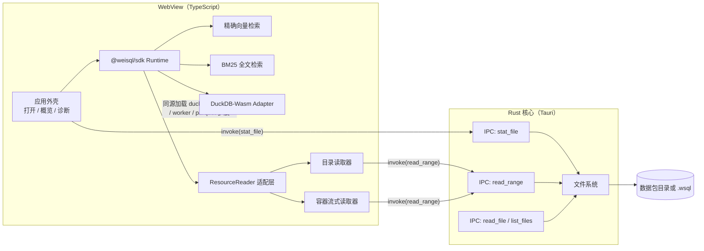
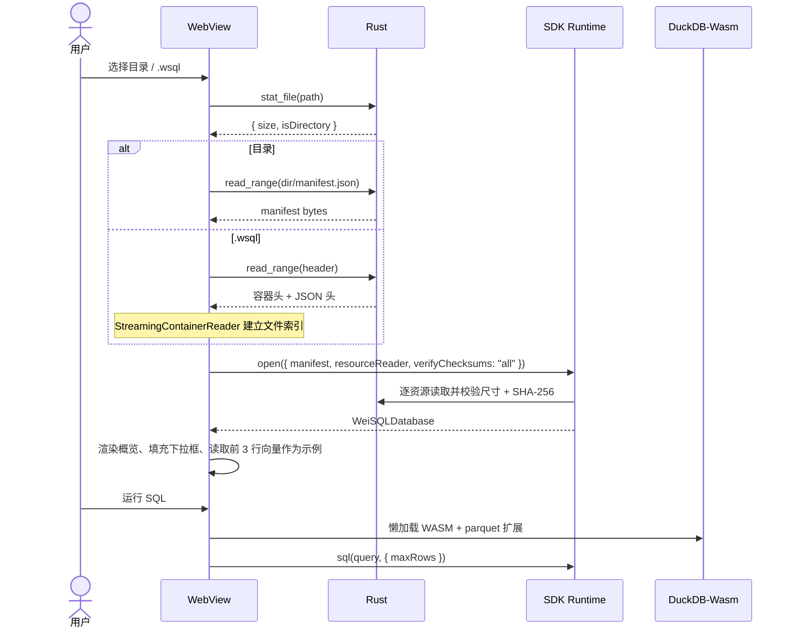

# WeiSQL Desktop 客户端设计文档

| 项目 | 内容 |
| --- | --- |
| 文档版本 | v1.0（设计评审稿） |
| 状态 | 范围与架构待评审；实现暂缓 |
| 日期 | 2026-10-31 |
| 关联文档 | [SDK API 契约](SDK_API_CONTRACT_V1.md)、[资源读取器契约](RESOURCE_READER_CONTRACT.md)、[`.wsql` 容器](WSQL_CONTAINER.md)、[DuckDB-Wasm Adapter](DUCKDB_WASM_ADAPTER.md)、[Manifest V1](MANIFEST_SPEC_V1.md) |
| 原型代码 | [`apps/desktop/`](../apps/desktop/README.md)（探索性脚手架，不作为交付物） |

> 本文只描述**目标设计**。原型已经验证了前端构建、内置示例与浏览器端 SQL/向量/全文查询，但 Tauri 原生层尚未达到可运行状态；差距与已知问题见附录 A。

---

## 1. 背景与问题

WeiSQL 的消费者目前有三种形态：

1. 静态网站里的浏览器 SDK；
2. Node.js 进程里的 SDK + 原生 DuckDB Adapter；
3. 命令行 `weisql`（校验、打包、检查、签名）。

缺少一个**面向人的本地查看器**：拿到一个数据包（目录或 `.wsql`）后，不写代码就能确认里面有什么、SQL 是否按预期返回、向量与全文检索是否命中、完整性是否通过。这个需求在数据交付验收、CI 产物排查、销售演示和内容运营核对时反复出现。

现有 Playground 是网页：它假设数据包已经通过 HTTP 提供，无法直接打开本地目录；也不适合作为离线工具分发。因此需要一个桌面客户端，把「选择本地文件 → 用 SDK 打开 → 查询 → 看结果」这条链路做成可安装的应用。

### 1.1 一句话目标

用一个只读、离线、跨平台的桌面应用，把 WeiSQL 数据包变成可浏览、可查询、可验证的本地对象。

### 1.2 非目标

- 不做数据生产工具：不编辑 Parquet、不构建数据包、不写入 Manifest。
- 不做数据库服务：不监听端口、不接受远程连接、不提供多用户并发。
- 不在 MVP 内做数据包签名与密钥管理 UI（CLI 已覆盖）。
- 不做通用 SQL 客户端（不连接 PostgreSQL/MySQL，不做 ER 图、不导出 CSV）。
- 不在 MVP 内承诺移动端。

---

## 2. 用户与场景

| 角色 | 场景 | 成功标准 |
| --- | --- | --- |
| 数据交付方 | 把数据包发给客户前，自己先打开确认表结构、行数与检索效果 | 3 分钟内完成一次「打开 → 预览 → 检索」 |
| 应用开发者 | 调试「为什么线上检索结果不对」，需要看同一份包的本地结果 | 本地结果与线上 SDK 结果一致，可看到距离/分数与诊断字段 |
| 内容运营 | 只关心某条文档是否在包里、全文能否搜到 | 不写 SQL 也能用全文检索定位 |
| CI/发布排查 | 下载构建产物后确认 `manifest.json` 与资源未损坏 | 打开即给出 L3 校验结论，失败时指出具体资源 |

关键用户旅程（MVP）：

```text
启动应用
  → 选择「打开目录 / 打开 .wsql」
  → 看到数据集摘要与 L3 校验结果
  → 概览里浏览表、列、主键、向量集合、全文索引
  → 在 SQL 页执行一条只读查询
  → 在向量页用真实向量检索 topK
  → 在全文页输入关键词查看 BM25 命中
  → 关闭应用（不留下写操作）
```

---

## 3. 需求

### 3.1 功能需求

优先级：P0 = MVP 必须；P1 = 首个正式版应有；P2 = 后续增强。

| ID | 需求 | 优先级 | 验收标准 |
| --- | --- | --- | --- |
| FR-01 | 打开数据包目录 | P0 | 原生目录选择器；打开后显示 `datasetId`、格式版本、表数量；读取只发生在用户选择的目录内 |
| FR-02 | 打开 `.wsql` 单文件 | P0 | 通过文件选择器选择 `.wsql`；只读取容器头与按需区间，不要求把整文件载入内存 |
| FR-03 | 打开内置示例 | P0 | 首次启动或点击「示例数据包」可离线打开随应用分发的示例包 |
| FR-04 | L3 完整性校验 | P0 | 打开时校验所有声明资源的尺寸与 SHA-256；成功显示「已校验」，失败阻止进入查询并列出资源路径与原因 |
| FR-05 | 概览 | P0 | 展示数据集、格式、模式、表、列（名称/类型/可空/主键）、向量集合（名称/行数/维度/度量/字节）、全文索引（名称/列/文档数/词项数） |
| FR-06 | 只读 SQL | P0 | 可执行 `SELECT`/`WITH`（只读 CTE）；写语句被拒绝并显示错误码；结果表格展示列名与值；可设置返回行数上限 |
| FR-07 | 查询耗时与行数 | P1 | 每次查询显示耗时与返回行数；超出行数上限时明确报错而不是静默截断 |
| FR-08 | 向量检索 | P0 | 选择集合、输入查询向量（或读取真实示例向量）、设置 topK；展示 row/id/distance 与 `exact` 诊断 |
| FR-09 | 向量过滤 | P1 | 可按声明列做等值/成员/范围过滤；过滤查询明确使用 `exact-filter-first`，并显示「已过滤」 |
| FR-10 | 全文检索 | P0 | 选择索引、输入关键词、设置 topK；展示 row/id/score；无索引时禁用并说明原因 |
| FR-11 | RAG 证据预览 | P2 | 在全文命中基础上组装证据，展示来源、名次、字符预算与截断边界 |
| FR-12 | 混合检索（RRF） | P2 | 同时输入查询向量与关键词，展示两路名次与融合名次 |
| FR-13 | 诊断面板 | P1 | 显示读取调用次数、读取字节、SQL 运行时是否加载、后端类型（Tauri IPC / 浏览器） |
| FR-14 | 错误呈现 | P0 | 所有失败都有可读消息；保留 `WeiSQLError.code` 便于对照文档；不出现只显示 `[object Object]` 的错误 |
| FR-15 | 最近打开 | P2 | 记录最近 5 个包路径（仅本地），支持一键重开；路径失效时给出提示 |
| FR-16 | 拖放打开 | P1 | 把目录或 `.wsql` 拖到窗口即可打开；多选时取第一个并提示 |
| FR-17 | SQL 结果流式渲染 | P2 | 使用 `sqlStream()` 首行即渲染，长结果可取消 |
| FR-18 | 导出查询结果 | P2 | 将当前 SQL 结果导出为 CSV/JSON；只导出查询结果，不改数据包 |

### 3.2 非功能需求

| ID | 需求 | 目标 / 验收 |
| --- | --- | --- |
| NFR-01 | 只读 | 应用不存在写数据包路径；Rust 命令只提供读操作；SQL 适配器拒绝写语句 |
| NFR-02 | 离线可用 | 除首次构建资源外，运行期不访问网络；SQL 的 WASM 与 parquet 扩展随应用分发 |
| NFR-03 | 启动 | 冷启动到窗口可交互 ≤ 2 s（目标，待测） |
| NFR-04 | 打开 | 100 MB 目录包打开（含 L3 校验）≤ 3 s（本地 SSD，目标，待测） |
| NFR-05 | 内存 | 仅浏览 + 向量/全文时 RSS ≤ 300 MB；加载 DuckDB-Wasm 后 ≤ 800 MB（目标，待测） |
| NFR-06 | 大文件 | 单次范围读取 ≤ 512 MiB；`.wsql` 打开不随文件大小线性占用内存（流式读取） |
| NFR-07 | 跨平台 | Windows 10/11 首发；macOS 13+ 与 Linux（WebKitGTK）在 P1 验证 |
| NFR-08 | 可访问性 | 键盘可完成全部 P0 操作；焦点可见；文本对比度符合 WCAG AA |
| NFR-09 | 可观测 | 本地日志可开启；不采集遥测、不上传路径或查询内容 |
| NFR-10 | 可维护 | Rust 命令有单元测试；UI 有浏览器 E2E；发版有检查清单 |

---

## 4. 方案选择

| 方案 | 优点 | 缺点 | 结论 |
| --- | --- | --- | --- |
| Tauri 2 + WebView | 安装包小（复用系统 WebView）、Rust 文件访问可控、与现有 Rust 工具链一致 | WebView 版本差异；自定义协议下 WASM/Worker 需要验证；生态比 Electron 小 | **采用** |
| Electron | 生态成熟、Chromium 版本固定、WASM 行为可预测 | 安装包 100 MB+、内存占用高、需要单独维护 Node 侧文件桥 | 备选（若 WebView 阻断 WASM 再评估） |
| 纯 Web（增强版 Playground） | 零安装、复用现有代码 | 无法直接读本地目录（需用户选择文件夹 + File System Access API，兼容性受限） | 保留为开发预览，不作为客户端 |
| 本地 HTTP 服务 + 浏览器 | 实现简单 | 需要常驻端口、启动体验差、安全边界模糊 | 不采用 |

选型理由：

1. WeiSQL 的读取模型是**随机字节范围**，Rust 的 `File::seek + read_exact` 足够，且能精确控制边界。
2. 现有 SDK 与 DuckDB-Wasm Adapter 都能在 WebView 中运行，前端可复用 Playground 的验证过的路径。
3. 安装包体积是分发优势：DuckDB-Wasm 约 34 MB，若再叠加 Chromium 会接近 150 MB。

---

## 5. 总体架构



### 5.1 进程与线程

- **主进程（Rust）**：窗口、原生对话框、文件读取命令；不解析 Parquet、不执行 SQL。
- **WebView**：UI、SDK 校验与检索、DuckDB-Wasm（Worker 内）。
- **DuckDB Worker**：由 `@duckdb/duckdb-wasm` 创建，负责 WASM 执行；表数据由前端从 `ResourceReader` 读入后 `registerFileBuffer`。

这样划分的原因：SQL 引擎已经在 SDK 的浏览器路径中存在且经过探针验证，客户端不应再实现一套 SQL；Rust 只做它擅长且必须受控的文件 I/O。

### 5.2 目录结构（目标）

```text
apps/desktop/
├── src/                    # 前端：无框架，Vite + TypeScript
│   ├── app.ts              # 会话状态、打开流程、各视图交互
│   ├── backend.ts          # Tauri invoke 封装
│   ├── readers.ts          # ResourceReader / ContainerByteSource / 示例包
│   ├── duckdb.ts           # 懒加载 DuckDB-Wasm 适配器
│   ├── dom.ts              # DOM 与格式化
│   └── main.ts             # 启动、拖放、测试钩子
├── src-tauri/
│   ├── src/lib.rs          # 4 个只读命令 + 单元测试
│   ├── tauri.conf.json
│   └── capabilities/default.json
├── scripts/                # 资源准备、图标生成
├── test/                   # 浏览器 E2E、Tauri E2E
└── public/                 # 构建期生成，git 忽略
```

---

## 6. 关键设计

### 6.1 打开数据包



设计要点：

1. **先校验后查询**：`verifyChecksums: "all"` 在打开阶段完成，避免用户看到「查询结果」后才发现资源损坏。对超大包（> 1 GB）提供后续「快速打开（仅尺寸）」开关（P1）。
2. **校验失败即阻断**：失败时清空会话，错误信息包含资源路径、期望/实际摘要，并保留在概览页。
3. **切换包先释放**：关闭旧 Runtime（SQL → 主 Runtime → Reader），再创建新会话，防止文件句柄与 WASM 堆泄漏。
4. **模式判定**：以 `stat_file().isDirectory` 判定，不依赖扩展名；`.wsql` 文件用容器魔数二次校验。

### 6.2 资源读取与字节范围

`ResourceReader` 契约保持不变（`read` / `readRange` / `stat` / `close`），桌面端实现两层：

| 层 | 职责 |
| --- | --- |
| `BackendDirectoryReader` | 把 Manifest 的相对路径与用户选择的根目录拼接；拒绝 `..`、绝对路径、反斜杠、空段；`stat` 使用真实文件大小 |
| `BackendContainerSource` + `StreamingContainerReader` | 把 `.wsql` 当作可随机访问的字节源；只读头部与按需文件区间 |
| `CountingReader` | 统计调用次数与字节数，供诊断面板；不改变语义 |
| `SampleReader` | 通过 HTTP 读取随应用分发的示例包，供浏览器预览与「示例」按钮使用 |

读取路径：

```text
SDK → reader.readRange("data/documents.parquet", { start, end })
    → Tauri invoke("read_range", { path: "D:/pkg/data/documents.parquet", start, end })
    → Rust: 绝对路径校验 → 打开文件 → seek → read_exact → 返回 ArrayBuffer
```

边界规则：

- `end < start`、`end > 文件长度`、单次跨度 > 512 MiB：拒绝并返回可读错误。
- 目录读取器对路径逐段检查；Rust 不负责把相对路径拼到根目录上，避免两套拼接逻辑不一致。
- 不跟随符号链接（`list_files` 跳过），避免目录逃逸与循环。

### 6.3 SQL 运行时

- **懒加载**：只有首次 SQL 或带过滤的向量检索才创建第二个 Runtime 与 DuckDB-Wasm 适配器。34 MB WASM 与 parquet 扩展不阻塞「打开 → 浏览」。
- **独立 Reader**：SQL Runtime 使用自己的 Reader 实例，避免关闭 SQL 时把主会话的 Reader 一起关闭；代价是重复读取 Manifest（已读字节很少）。
- **只读边界**：由 `@weisql/duckdb-wasm-adapter` 的关键字白名单与只读 CTE 分类保证；客户端不提供绕过入口。
- **结果上限**：默认 200 行，可配置 1–10000；超过上限由适配器返回 `INVALID_ARGUMENT`，UI 明示「结果未显示」而不是截断。
- **错误呈现**：显示 `code: message`，并把 `details` 折叠到提示中；SQL 失败时清空旧结果，避免把上一次结果误认为本次结果。

### 6.4 向量与全文

- 向量查询支持两种输入：手输逗号分隔数字；从包内读取前 3 行真实向量作为示例（避免示例硬编码维度/分布）。
- 维度不符在客户端先校验，错误信息给出期望维度与实际数量。
- 带过滤时先 `ensureSql()`，再调用 `vector.search(..., { filter })`；UI 标注「已过滤」，并展示 `diagnostics.exact`。
- 全文检索无索引时禁用输入与按钮，并在面板中说明原因，而不是等用户点击后报错。

### 6.5 完整性

| 模式 | 时机 | 行为 |
| --- | --- | --- |
| `all` | 打开（默认） | 校验尺寸 + SHA-256（含 ID Map 内容） |
| `manifest` | 大包快速打开（P1） | 只校验声明尺寸 |
| `none` | 仅开发诊断（默认不暴露） | 不校验，UI 显示黄色警告 |

校验结论只分为「通过 / 失败 / 未校验」三态，不使用模糊措辞。

---

## 7. IPC 契约

命令参数使用 camelCase（Tauri v2 默认映射到 Rust snake_case 参数）。所有命令返回 `Result<T, String>`，错误字符串包含路径与原因。

| 命令 | 请求 | 响应 | 失败条件 |
| --- | --- | --- | --- |
| `stat_file` | `{ path: string }` | `{ size: number; isDirectory: boolean; lastModified?: number }` | 非绝对路径；路径不存在；无权限 |
| `read_range` | `{ path: string; start: number; end: number }` | 原始 `ArrayBuffer` | `end < start`；越界；跨度 > 512 MiB；IO 错误 |
| `read_file` | `{ path: string }` | 原始 `ArrayBuffer` | 非绝对路径；文件 > 512 MiB；IO 错误 |
| `list_files` | `{ path: string }` | `{ path: string; size: number }[]` | 非目录；无权限；超过 20 000 条或 24 层时截断 |

约束：

1. 命令只接受绝对路径；相对路径一律拒绝，防止把解析基准交给进程工作目录。
2. `read_range` / `read_file` 返回二进制而非 JSON/base64，避免 33% 膨胀与额外解析。
3. `list_files` 返回相对路径（`/` 分隔），用于「Manifest 未声明的文件」诊断（P1），不在 MVP 阻塞打开流程。
4. 自定义命令不需要 capability 授权；窗口仅申请 `core:default` 与 `dialog:default`。
5. 未来若增加 `open_package` 或 `watch_package`，必须同步更新本表与 Rust 单元测试。

---

## 8. 安全与隐私

| 面 | 措施 | 备注 |
| --- | --- | --- |
| 写操作 | Rust 只暴露读命令；SQL 适配器只读 | 代码审查 + 适配器测试双重保证 |
| 路径 | 前端逐段校验；Rust 只接受绝对路径 | 不把「根目录 + 相对路径」的拼接放进 Rust |
| 范围 | 每次读取校验 `0 ≤ start ≤ end ≤ 文件长度` | 防止越界读与短读 |
| 符号链接 | 目录遍历跳过 | 防止逃逸与循环 |
| 网络 | 运行期不发起网络请求 | 资源全部本地；示例包随应用分发 |
| WebView | 生产环境配置显式 CSP（`script-src 'self' 'wasm-unsafe-eval'`、`worker-src 'self' blob:`、`connect-src ipc: http://ipc.localhost`） | 原型暂为 `csp: null`，发布前必须收紧并验证 WASM/Worker |
| 遥测 | 无 | 日志默认关闭，用户可在设置中打开 |
| 更新 | 签名校验（minisign）+ HTTPS | 与 Tauri updater 集成，P1 |
| 供应链 | 锁定依赖、CI 构建、发布前检查 | 复用仓库现有 release 流程 |

不在安全模型内：恶意数据包对 WASM/Parquet 解析器的 0-day。缓解方式是保持 DuckDB-Wasm 版本更新，并在打开不可信包时提示风险（P2）。

---

## 9. 界面与交互

### 9.1 信息架构

```text
┌──────────────────────────────────────────────────────────────┐
│ Logo  WeiSQL Desktop   [数据包路径]      打开目录  打开 .wsql  │
├───────────────┬──────────────────────────────────────────────┤
│ 数据包摘要     │ 概览 │ SQL │ 向量检索 │ 全文检索              │
│ 完整性         ├──────────────────────────────────────────────┤
│ 能力           │ 表卡片（列/类型/主键/预览）                    │
│ 诊断           │ 向量集合 / 全文索引                            │
├───────────────┴──────────────────────────────────────────────┤
│ 状态栏：最近操作 · 读取字节 · 后端类型                          │
└──────────────────────────────────────────────────────────────┘
```

- 空状态：一句说明 + 三个入口（打开目录 / 打开 `.wsql` / 示例）。
- 侧栏固定显示包级信息，切 Tab 不丢失上下文。
- 错误就地显示在对应面板顶部，同时写入状态栏；不使用模态框打断浏览。

### 9.2 关键交互

| 操作 | 交互 | 反馈 |
| --- | --- | --- |
| 打开 | 原生对话框；拖放 | 按钮禁用 + 状态「正在打开…」 |
| 校验失败 | 阻止进入查询 | 概览页红色错误块，含资源路径 |
| SQL | `Ctrl/Cmd + Enter` 运行 | 耗时 + 行数；失败清空结果 |
| 向量 | 选择集合 → 读取示例向量 / 手输 → 检索 | 命中表 + `exact` 诊断 |
| 全文 | 输入关键词回车 | 分数 + 耗时；无索引时禁用 |
| 切换包 | 关闭旧会话再打开 | 诊断计数归零 |

### 9.3 可访问性

- 所有按钮可 Tab 聚焦，`:focus-visible` 有明显描边。
- Tab 使用 `role="tab"` / `aria-selected`；面板切换同步 `hidden`。
- 结果表有表头；空结果与错误均以文本说明，不只靠颜色。
- 支持 `prefers-color-scheme` 明暗两套配色，对比度 ≥ 4.5:1。

### 9.4 文案

- 界面语言：简体中文；代码与字段名保留英文。
- 错误文案结构：`做什么失败 + 原因 + 下一步`，例如「打开失败：`data/x.parquet` 的 SHA-256 不匹配（期望 …, 实际 …）。请重新获取数据包。」
- 不使用「似乎」「可能」等模糊措辞描述校验结果。

---

## 10. 性能预算与测量

| 指标 | 预算 | 测量方法 | 状态 |
| --- | --- | --- | --- |
| 冷启动到可交互 | ≤ 2 s | 启动打点 → 首屏 `requestAnimationFrame` | 待测 |
| 打开 10 MB 目录包（含 L3） | ≤ 800 ms | 打开按钮 → 概览渲染 | 待测 |
| 打开 100 MB 目录包（含 L3） | ≤ 3 s | 同上 | 待测 |
| 打开 100 MB `.wsql` | ≤ 500 ms（仅头部） | 同上，记录读取字节 | 待测 |
| SQL 首次查询（含 WASM） | ≤ 8 s | 点击运行 → 首行渲染 | 浏览器预览已通过，未计时 |
| SQL 后续查询（1 万行内） | ≤ 100 ms | 同上 | 待测 |
| 精确向量 topK=10（100k×128） | ≤ 300 ms | SDK 诊断 `elapsedMs` | 依赖磁盘，待测 |
| 全文 topK=10（100k 文档） | ≤ 50 ms | 同上 | 待测 |
| 安装包体积 | ≤ 80 MB | 构建产物 | 待测（WASM 约 34 MB） |
| 空闲内存 | ≤ 300 MB | 任务管理器 / `Get-Process` | 待测 |

原则：所有数字必须标注环境与数据规模；没有测量的指标不写进对外材料。

---

## 11. 打包与发布

### 11.1 产物

| 平台 | 格式 | 备注 |
| --- | --- | --- |
| Windows | MSI（WiX）+ NSIS | 首发；WebView2 采用「下载引导」而非固定版本 |
| macOS | `.app` + `.dmg`（universal） | P1；需要公证 |
| Linux | `.deb` + AppImage | P1；依赖 WebKitGTK |

### 11.2 版本与签名

- 应用版本与数据包 `formatVersion` 解耦；`productName` = `WeiSQL Desktop`，identifier = `ai.weisql.desktop`。
- Windows 使用 Authenticode 证书签名；macOS 使用 Developer ID + notarization。
- 自动更新（P1）：Tauri updater + minisign 公钥内置；更新源必须是 HTTPS 静态文件。

### 11.3 CI

- `desktop` 作业：`npm ci` → `npm run build`（前端）→ `cargo test` → `cargo tauri build --no-bundle`。
- 发布作业：三平台矩阵构建安装包，校验文件名、版本、签名，上传 release 资产。
- 体积回归：记录安装包与 `dist` 大小，超过预算时失败。

---

## 12. 测试策略

| 层级 | 范围 | 工具 | 退出标准 |
| --- | --- | --- | --- |
| Rust 单元 | 范围边界、越界、相对路径、目录遍历 | `cargo test` | 全部通过 |
| 前端单元 | 路径守卫、过滤值类型转换、数值解析 | `node:test`（或 Vitest） | 全部通过 |
| 浏览器 E2E | 内置示例 → 概览 → SQL → 向量 → 全文 | Playwright + `vite preview` | 断言数据集、行数、命中 ID |
| Tauri E2E | 真实 IPC + 目录 / `.wsql` 打开 | Playwright `connectOverCDP`（WebView2 远程调试端口） | 打开真实目录并完成一次 SQL |
| 手工检查 | 原生对话框、拖放、窗口缩放、明暗主题 | 检查清单 | 每平台每版本一次 |
| 安全用例 | 路径穿越、超大范围、符号链接、篡改包、截断包 | 单元 + 集成 | 全部拒绝且错误可读 |
| 兼容性 | Windows 10/11、macOS 13+、Ubuntu 22.04 | 虚拟机 | P0 流程通过 |

测试数据：

1. 提交的 `examples/fixture`（3 行，含向量）；
2. 构建期生成的示例包（追加全文索引）；
3. `tools/bench` 生成的 10 万行包（性能）；
4. 篡改包（改一个字节，验证 L3 失败）；
5. gzip `.wsql`（1.1.0）与未压缩 `.wsql`（1.0.0）；
6. Unicode 路径与超过 260 字符的 Windows 路径。

---

## 13. 里程碑

### M0 设计与决策（本阶段）

- 交付：本文档；范围、非目标、IPC 契约、里程碑冻结。
- 退出标准：评审通过；未决问题有明确 owner 与截止时间。
- 明确不做：编码。

### M1 骨架可运行

- 任务：修复 Rust 命令宏冲突；窗口启动；目录打开；概览与 L3 校验；内置示例。
- 退出标准：`cargo test` 全绿；`cargo tauri dev` 可打开示例目录并看到表结构；Windows 安装包可构建（未签名）。

### M2 查询闭环

- 任务：SQL 面板、向量检索、全文检索、错误呈现、诊断面板；浏览器与 Tauri E2E。
- 退出标准：三条查询链路在真实 IPC 下通过；错误路径有测试；性能预算首次测量并记录。

### M3 打包与发布

- 任务：三平台构建、图标、签名、更新通道、体积检查、README 与用户手册。
- 退出标准：签名安装包在干净机器安装并完成 P0 流程；升级路径验证。

### M4 增强

- 任务：ANN、`sqlStream()`、RRF/RAG、OPFS、最近打开、CSV 导出、远程 URL、多语言。
- 退出标准：按单项需求验收，不合并成「大版本」。

---

## 14. 风险与对策

| 风险 | 概率 | 影响 | 对策 |
| --- | --- | --- | --- |
| DuckDB-Wasm 在 Tauri 自定义协议下无法加载 Worker/WASM | 中 | 高（SQL 不可用） | M1 先做最小验证；失败则改用 `http://tauri.localhost` 或内置本地 HTTP 服务；再失败评估 Electron |
| parquet 扩展同源路径在打包后 404 | 中 | 高 | 构建期把扩展放入 `public/extensions/<version>/wasm_eh/`；E2E 断言 SQL 能建表 |
| 安装包过大（WASM 34 MB） | 高 | 中 | 懒加载；安装包压缩；文档说明体积构成；P2 评估按需下载扩展 |
| WebView2 版本差异导致 API 不兼容 | 中 | 中 | 只使用稳定 Web API；CI 在最低支持版本上跑 E2E |
| L3 校验大包耗时长 | 中 | 中 | 提供「快速打开」；显示进度；后台校验 + 可取消（P1） |
| `.wsql` 容器索引损坏导致越界读 | 低 | 中 | 复用 SDK 的连续性与边界校验；Rust 二次校验范围 |
| 原生对话框在 Linux 上依赖 portal | 低 | 低 | 文档说明；P1 验证 |
| 依赖版本漂移（Tauri/插件） | 中 | 中 | 锁定 minor；升级走单独 PR + 全量 E2E |
| 代码签名证书缺失 | 高 | 中 | 先用未签名内测；发布前补齐证书与流程 |

---

## 15. 未决问题

| # | 问题 | 需要谁决定 | 影响 |
| --- | --- | --- | --- |
| Q1 | 首发是否只做 Windows？macOS/Linux 是否阻塞 v1.0？ | 产品 | 里程碑与测试矩阵 |
| Q2 | 是否内置自动更新？更新源由谁托管？ | 产品/运维 | 签名、发布流程、隐私说明 |
| Q3 | 是否需要打开远程 URL（CDN 上的包）？ | 产品 | Reader 抽象、CORS/Range 处理 |
| Q4 | RAG/混合检索是否进入 MVP？ | 产品 | 前端工作量、依赖能力矩阵 |
| Q5 | 是否需要客户端内构建/打包（写能力）？ | 产品 | 安全模型从只读变为读写，需重新评审 |
| Q6 | 品牌名、图标、安装包 publisher 信息 | 设计/法务 | 打包与签名 |
| Q7 | 大包快速打开是否默认开启？ | 工程 | 完整性与体验的权衡 |

---

## 附录 A：原型现状（2026-10-31）

`apps/desktop/` 下已有一个探索性脚手架，用于验证技术路线，**不是可交付版本**。

### A.1 已验证

| 项 | 结果 |
| --- | --- |
| 前端类型检查（`tsc --noEmit`） | 通过 |
| 前端构建（`vite build`） | 通过；DuckDB-Wasm 动态分块 |
| 浏览器 E2E（内置示例） | 通过：概览、SQL（`count(*) = 3`）、向量（3 条命中）、全文（命中 `doc-001`） |
| 资源流水线 | 通过：DuckDB-Wasm 1.4.3 + 同源 parquet 扩展 + 生成全文索引的示例包 |
| 图标生成 | 通过（Tauri icon 全套产物） |

### A.2 未完成 / 已知问题

| 项 | 状态 | 说明 |
| --- | --- | --- |
| Rust 单元测试 | 失败 | `cargo test` 在 `#[tauri::command]` 展开处报 `E0255: __cmd__* 重复定义`（4 个命令 ×2）；需把命令移入独立模块或调整 Tauri/插件版本后重试 |
| Tauri 窗口启动 | 未验证 | 依赖上一条修复 |
| 原生文件对话框 | 未验证 | 同上 |
| `.wsql` 真实文件读取 | 未验证 | 读取器已实现，缺少集成测试 |
| 打包 | 未验证 | 未运行 `cargo tauri build` |
| CSP | 临时关闭 | 原型使用 `csp: null`，发布前必须收紧 |

### A.3 复现问题

```text
cargo test --manifest-path apps/desktop/src-tauri/Cargo.toml
error[E0255]: the name `__cmd__list_files` is defined multiple times
  --> src\lib.rs:156:8
```

下一步建议（M1 第一项任务）：把 4 个命令移动到 `src-tauri/src/commands.rs`，在 `lib.rs` 中 `mod commands; pub use commands::*;`，并确认 `tauri`、`tauri-plugin-dialog`、`tauri-plugin-fs` 三者版本互相兼容；若仍复现，用最小仓库（仅一个命令）二分定位宏展开来源。

### A.4 环境备注

本机 `static.crates.io` 直连不可达，验证时通过 rsproxy 镜像拉取依赖；仓库交付物不包含该镜像配置，CI 应使用官方 registry 或团队约定的镜像。

---

## 附录 B：与现有文档的关系

| 文档 | 关系 |
| --- | --- |
| `docs/SDK_API_CONTRACT_V1.md` | 客户端只使用其中的公开 API；不新增 SDK 能力 |
| `docs/RESOURCE_READER_CONTRACT.md` | 桌面 Reader 必须满足该契约；`close()` 幂等 |
| `docs/WSQL_CONTAINER.md` | `.wsql` 的读取语义与错误码来源 |
| `docs/DUCKDB_WASM_ADAPTER.md` | SQL 限制（无 `Date`/二进制参数、只读白名单）直接适用于客户端 |
| `docs/TABLE_LOADING_OPTIONS.md` | 表物化预算与内存上限；客户端默认值需与之一致 |
| `docs/RELEASE_PROCESS.md` | 打包与发布检查清单的基线 |

---

## 附录 C：文档维护

- 本文与实现不一致时，以本文的契约章节为准，先改文档再改代码。
- 每次里程碑结束更新附录 A；发布前把「待测」替换为带环境的实测数字。
- 未决问题关闭后，在本文件记录结论与日期，不留在聊天记录里。
